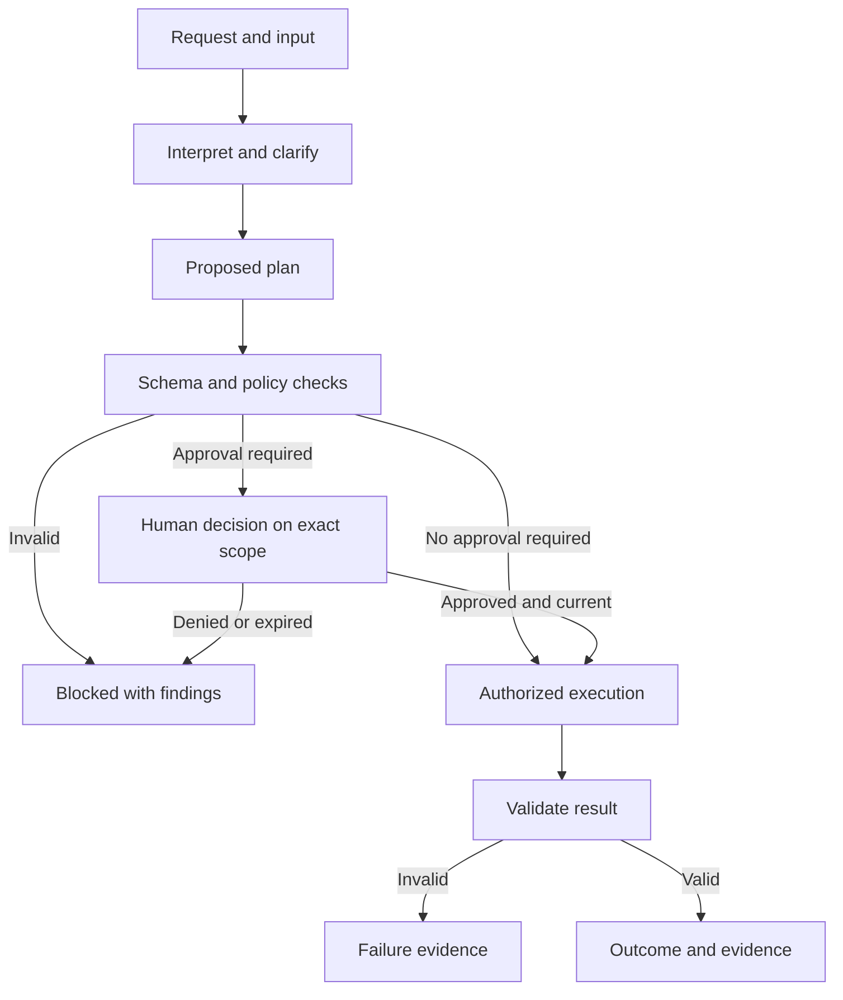
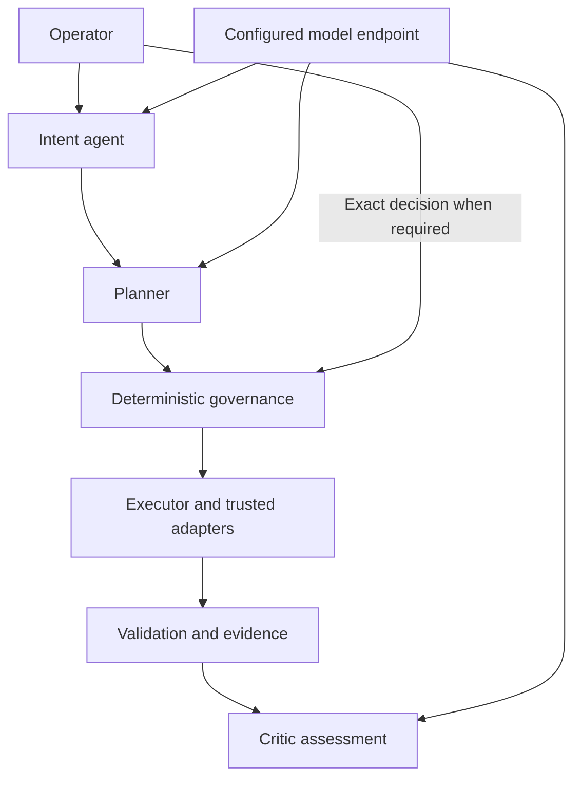

# ActionCharter

[](https://github.com/wanggiya/action-charter/actions/workflows/test.yaml)
[](https://github.com/wanggiya/action-charter/actions/workflows/container-build.yaml)
[](LICENSE)
[](pyproject.toml)
[](https://codespaces.new/wanggiya/action-charter?quickstart=1)

**Local AI-assisted data workflows with explicit approval and verifiable results.**

Describe a task, inspect the proposed steps, and run supported operations through a governed backend. Models help interpret requests and assess evidence; deterministic software checks scope, permissions and results. The interface and CLI use the same backend contracts.

Narrow single-file metadata inspection requests reject unrelated operations before saving a proposal; broader task coverage remains model-dependent. [Inspection on send](docs/CHECKPOINT28_2_INSPECTION_SUBMIT.md) adds an explicit, default-OFF composer setting: eligible local CSV, vector or raster metadata inspections can run on send within fixed batch limits. Other proposals retain Execute; writes retain Allow writes → Authorize → Execute.

Supported domains now include bounded pandas-backed CSV processing and geospatial data: vector and raster inspection/conversion, PostGIS workflows and bounded GeoServer inspection/publication. Local Ollama is supported through an OpenAI-compatible model endpoint.

[Vector-first spatial exploration](docs/CHECKPOINT28_3_SPATIAL_VIEWS.md) adds explicit source-verified layer selection, display reprojection and linked attributes, followed by bounded raster grayscale/color/RGB/class views with NoData and exact pixel inspection. Planner can select recorded layers/bands/render settings conversationally and request backend-formatted explanations of saved facts. Exact recorded count/dimension questions need no model call or source reread. Viewing does not authorize or execute processing; preview limits remain visible.

[Typed result exploration — 28.3](docs/CHECKPOINT28_3_RESULTS.md) adds complete bounded CSV filtering/sorting/paging, column profiles and filtered chart totals. Planner can propose a scoped recorded-result view without replacing or executing the workflow; normal view reopening uses saved snapshots.

Selected workflow operations now show their recorded formula, input/output paths,
bounded table preview and readable validation checks in the information panel.
Results restore only for the matching chat and plan; drafts show no inherited
execution evidence. [Recorded-result validation guide](docs/CHECKPOINT27_RECORDED_RESULTS.md).
[Recorded visualizations](docs/CHECKPOINT27_VISUALIZATION.md) began with bar/scatter and point previews. [Analysis and layout delivery](docs/CHECKPOINT27_ANALYSIS_AND_LAYOUT.md) adds ten chart views (including pie/donut), explicit hash-verified full-CSV grouping, and bounded WGS84 points, lines, polygons/holes and attributes. Ordinary viewing uses recorded snapshots; analysis requires an explicit read. No tiles or live database queries are implied.
The [Results workspace](docs/CHECKPOINT27_RESULTS_WORKSPACE.md) opens through Outcome or View output, with connected Overview/Table/Map/Chart/Checks page tabs, a visible resize divider and expansion. Tables search/sort/page loaded rows; point/table selections link. Load verified CSV explicitly checks the recorded artifact hash for a larger bounded preview; ordinary viewing uses saved snapshots.

[Checkpoint 27 technical acceptance](docs/CHECKPOINT27_EVALUATION.md): 1,825 tests and six correct local-model fixture executions in the final profile. Optional Critic assessment timed out in all six; broader model reliability and the pre-demo capability/learning/memory gates remain explicit limitations.

**Status: single-operator alpha.** Existing recipe workflows can execute through the interface. Planner agent now offers exact-scope execution for supported inspection and recipe workflows. The separate Context & intent journey still has integration limits. This is not yet a packaged desktop app or a hardened multi-user service.

[Optional capability acquisition — 28.1 pilot](docs/CHECKPOINT28_1.md) adds a default-OFF per-chat switch. Planner can propose a closed CSV text-cleaning adapter, the backend tests synthetic/held-out cases, and Critic assesses applicability. One explicit install action registers the exact tested definition and asks Planner for a normal workflow. Installation grants no write or execution authority. This is a restricted data-only adapter family, not arbitrary Python generation, RL or general library-function execution. Linux resource-bounded testing currently requires the existing pinned pandas runtime. [Text-normalization example](examples/text-normalization/README.md). The bounded OFF/ON/changed-input-reuse local-model trial passed; this is not general model reliability or demonstrated speedup. See the delivery guide for prior failures, exact bounds and acceptance.

Planner chat retains its full transcript while sending bounded recent excerpts to the model. Previous-message context can be disabled without deleting history; the current workflow remains explicit context. Conversational Planner requests structural JSON-schema output and keeps full backend validation. Model errors distinguish malformed output, reported token truncation, timeout and configuration failures; [format compatibility and diagnostics](docs/PLANNER_STRUCTURED_OUTPUT.md). Supported Ollama models can optionally use `MODEL_REASONING_EFFORT=none` to test non-thinking generation; it is not a guaranteed timeout fix. Planned input-file nodes and inspector source paths show declared data scope. Existing saved workflow scope recovers on startup without model calls or execution. Planner reuse citations are constrained to supplied or successfully inspected sources; ordinary planning needs no recipe selection. Explicit calculated-column requests receive a narrow missing-operation check with one correction and simple single-column requests use a decoder operation skeleton; summaries alone do not establish calculation support. The information panel lists actual workflow operations and calculation formulas; raw arguments, execution details, evidence and task history expand on demand. Per-chat graph positions persist in this browser and new blocks seek free space. Desktop Planner/information panels resize; outcomes and workflow-source groups expand/collapse without execution. See [conversation context guidance](docs/CHECKPOINT24.md#conversation-context-and-model-diagnostics).

Saved history uses chat bubbles. History/context controls collapse together to save room, and a drag handle resizes the message-writing area. Planner labels distinguish **Saved chat history** from **Context sent to Planner**. The single **Chat memory** switch controls recent-message inclusion. OFF keeps the saved transcript and current workflow. Its preference stays the same across chats and refreshes in this browser. Settings’ Include private declarations switch is also remembered. The disclosure separates your next request from the actual last-completed-request receipt. Other conversations are not pooled into chat context. **Cross-chat memory is deferred until checkpoint 30 or later**, after intervening operational/privacy work and a fresh operator decision; see [deferred scope](docs/DEFERRED_CROSS_CHAT_MEMORY.md).

The [post-calculation delivery plan](docs/POST_CALCULATION_DELIVERY_PLAN.md) separates remaining result-panel/evaluation work from proposed bounded capability acquisition, optional learning-policy experiments and private domain knowledge. General generated-code acquisition and RL/model training are not implemented. Planned [capability acquisition](docs/OPTIONAL_CAPABILITY_ACQUISITION_PLAN.md) is optional, OFF by default and task-scoped: use existing operations/recipes first, propose a bounded addition only for a demonstrated gap, and reuse accepted installed versions. This switch would not authorize installation or execution. [Runtime write controls and acceptance](docs/CHECKPOINT27_RUNTIME_WRITES.md) describe the implemented checkpoint 27.7 slice and its limitations. The warning-labelled Allow writes switch beside Authorize/Execute and Settings share session write availability without routine restarts; exact authorization remains required and overwrite stays separate. [Conservative report authorization](docs/CHECKPOINT27_AUTHORIZATION_FIX.md) now retains plan gates for evidence-only recipes; approving still performs no operation. The operator requires generated capabilities, the learning/RL pilot and advanced private memory to be implemented and validated before demo or real-data testing; those gates remain unfinished.

Execution History lists saved workflow runs by input filename, operation and time at the top. Choose **View outcome** to reopen saved evidence without replacing the current workflow or executing it. Cancellation/recovery controls remain accessible from the same section.

[Discovery consolidation](docs/CHECKPOINT28_DISCOVERY_RESTRUCTURE.md) records the baseline, revised target and delivery. CSV inspection streams preliminary characteristics, full row/missing counts and SHA-256 without a dataframe. TIFF, closed GeoPackage and Shapefile discovery reads driver metadata then streams a package hash without loading pixels or geometry tables. Guards are 1 GiB / 120 seconds per reader; synthetic CSV/TIFF measurements cover 16/64 MiB, not arbitrary real-world scale. GeoJSON, transformations and spatial displays retain separate limits. [Checkpoint 28 acceptance](docs/CHECKPOINT28_CLOSEOUT.md) and [work resume](context/WORK_RESUME.md) distinguish engineering delivery from unfinished learning/private-knowledge and demo gates.

Exact supported Inspect requests now prepare workflows without model calls through
durable submissions. Inspect on send OFF only prepares; ON permits eligible local
reads, including 1–4 distinct sources with a 1 GiB aggregate budget. For mixed
formats use `Inspect sample_orders.csv and sample_dem.tif. Return metadata. No writes.`
Outcome selects each recorded operation. Broader/ambiguous requests retain Planner;
writes retain their exact controls. CLI `submit-inspection` shares this coordinator
(preparation by default; `--execute` for permitted reads). CLI `discover-dataset`
and MCP `discover_dataset` share the bounded discovery service. Legacy inspector
contracts remain compatible. Restart/refresh for submission revision `inspection-batch-v5`.

[Inspection expansion](docs/INSPECTION_ON_SEND_EXPANSION.md) supports bounded single-dataset CSV/TSV, GeoJSON, GeoPackage, closed Shapefile and self-contained GeoTIFF inspections on Linux. Multi-step and service inspections remain on Execute.

Raster Outcome Overview now includes readable extent, resolution, data types and
NoData, with expandable technical metadata: CRS WKT, compression/layout, per-band
blocks, color interpretation, units, scale/offset, stored tags and band-1 overview
dimensions. Metadata is bounded and does not compute pixel statistics/histograms.
Map opacity shows endpoints and its current percentage; the reported endpoint
fault has not been reproduced in mouse/keyboard checks. See the discovery guide
for current limits and validation.

[Learning without RL](docs/LEARNING_WITHOUT_RL.md) records the next evaluated reuse/retrieval direction. Existing outcome ranking is experimental; no model training or general learning benefit is claimed.

## Why ActionCharter?

**Reusable recipes and durable runs:** Describe a task in Planner chat; recipes expand into editable, validated operations. Planner also drafts reusable recipes, isolated fixtures test them, and Critic reviews the candidate before optional registration. Execution engine records durable steps, cancellation and conservative recovery; Critic assesses recorded outcomes without changing deterministic status. No separate Builder is needed for this journey. [Checkpoint 26 closeout and validation](docs/CHECKPOINT26_CLOSEOUT.md). Transactional resume, parallel execution and indexed/cross-chat memory remain deferred.

The graph now shows a secondary [Critic review · advisory](docs/CHECKPOINT27_CRITIC_GRAPH.md) branch for requested recorded assessments. Select it for findings, limitations and run provenance; review status stays separate from execution and deterministic validation. Opening or refreshing it never repeats execution or assessment. During development, editing a plain TypeScript hook reloads the page to avoid stale React hook state; saved chats/workflows restore, while unsaved UI edits may reset.

**Each conversation is one task with private memory.** Keep geospatial and CSV work in the same chat: its transcript and latest validated plan persist when the topic changes. New chat starts separately; opening an older conversation restores that conversation's own state. No task selector or cross-chat memory sharing is required. Local SQLite adds no dependency or background agent. See [conversation acceptance](docs/CHECKPOINT26_CONVERSATIONS.md). Indexed core facts, automatic summaries and corrections remain planned single-conversation work. The normal UI uses saved chat/workflow context only: opening a chat automatically restores its latest validated workflow, without a model call or manual plan selection. An experimental **Automatic method notes** Settings switch enables a separate helper: one bounded request after a changed validated workflow, then cached machine-generated/unvalidated advice for later requests in that chat. It is OFF by default, adds no container/model and requires no manual method-management steps. Opening a chat still makes no model call. [Behavior, limits and frontend acceptance](docs/METHOD_MEMORY_HELPER_DESIGN.md#first-integration--implemented-experimental-scope) distinguish this workflow-only slice from future evidence learning/corrections. Cross-chat sharing remains deferred. See [scope, limitations and manual acceptance](docs/METHOD_MEMORY_PROTOTYPE.md). Memory never grants execution authority. Calculation planning recognizes “multiplied/divided” wording and includes a complete non-executing workflow example. Repeated schema-repair deferrals identify model-output failure without requesting technical authorization rules. Planner schema-repair permission deferrals receive one correction; repeated deferrals report failure without replacing a saved workflow. See [architecture](docs/PROJECT_MEMORY_ARCHITECTURE.md).

Giving a model access to a powerful tool is easy. The harder problem is proving
that an AI-assisted operation:

1. used the correct input;
2. selected an allowed operation;
3. remained inside an explicitly bounded scope;
4. received approval for the exact consequential steps;
5. executed only what was approved;
6. produced a valid result;
7. was independently verified; and
8. left evidence that can be inspected later.

Generated text never becomes authority merely because a model generated it.
ActionCharter turns an uncertain proposal into a chain of typed, digest-bound,
and independently checkable artifacts.

## What you can do

| Capability | Current behavior |
|---|---|
| Describe and clarify a task | Intent reasoning supports fresh requests or explicitly reviewed historical context |
| Inspect a plan | Typed steps, input scope and policy checks; graph and evidence inspection |
| Process tabular data | Inspect CSV/TSV, select/filter, fill/drop missing values, join, aggregate and export fresh CSV artifacts with bounded previews and exact approval; [checkpoint 24 examples](docs/CHECKPOINT24.md) |
| Calculate table columns | Typed arithmetic, comparisons and numeric conditionals; formula controls, explicit missing policy, bounded effort and independently checked fresh CSV outputs. [Behavior and testing](docs/BOUNDED_CALCULATIONS.md) |
| Combine spatial and tabular data | Inspect GeoJSON and extract flat attributes into validated CSV intermediates; geometry is deliberately omitted |
| Process spatial data | Registered vector/raster capabilities and governed PostGIS operations |
| Review and run recipes | Exact-scope decisions, bounded execution, validation and durable attempt records |
| Inspect results | Evidence, reports, independent checks and Critic assessment |
| Prepare reproducible workflows | Governed Snakemake export with static validation; export alone does not execute replay |
| Discover library capabilities | Installed Python package inventory and bounded static function/class/method discovery, searchable in Settings and CLI; candidates grant no authority |
| Develop extensions | Shared operation contracts, tested data-only CSV adapter packages and the existing Builder lifecycle; [checkpoint 25 guide](docs/CHECKPOINT25.md) |

CLI coverage is broader than the current interface. See [interface/CLI coverage](docs/INTERFACE_CLI_PARITY.md) and [current implementation status](context/CURRENT_STATUS.md).

## How work moves through the system



This diagram describes the backend authority model. It does not imply every plan shape has a complete interface route today. The legacy Intent/technical compiler still requires its separate continuation; current saved inspection plans can use the direct Execute review. Reviewed context, a stored plan and a success claim each remain distinct from execution permission.

## Agents and responsibilities



| Role | Responsibility | Authority boundary |
|---|---|---|
| Intent | Clarify the objective and explicit inputs | Cannot approve work or call processing tools |
| Planner | Compose/revise workflows and draft reusable recipes with fixtures | Cannot execute or grant permission |
| Execution engine | Deterministically dispatch supported, authorized operations | Cannot invent tools or use model output as authority |
| Critic | Assess checked evidence and reusable-recipe fixture findings | Cannot override deterministic status or create run authority |
| Builder · legacy extension path | Propose extension candidates; not used for normal recipe authoring | Proposals stay untrusted; tests/review do not grant execution authority |
| Method helper · experimental opt-in | Cached procedure notes from changed validated workflows | Unvalidated advice; no execution evidence, tools, sharing or authority |
| Operator | Review intent and make exact work decisions | A decision does not cover changed scope |

Governance and verification are software controls, not additional reasoning agents. Credentials remain behind the tool boundary.

## Start locally

The reference development environment is **Ubuntu 24.04 on WSL2**. Use Linux Python and Node inside WSL; mixing Windows executables with WSL paths can break installation.

Requirements: Python 3.11+, Linux Node.js 22.12+ and pnpm 10.17.1. Docker Compose is needed for container validation and containerized services. The lightweight agent image can show CLI help, inspect agent manifests and validate the recipe catalog without loading optional GIS libraries; GIS execution requires its GIS runtime. Ollama, PostGIS and GeoServer are needed only for their related actions; the launcher reports availability without starting them.

```bash
git clone https://github.com/wanggiya/action-charter.git
cd action-charter
make install
corepack pnpm@10.17.1 --dir interface install --frozen-lockfile
make inspect
```

`make inspect` reads the included `data/input/sample_points.geojson` and returns structured metadata without changing the dataset or loading it into a database. You can run the same check directly:

```bash
.venv/bin/geoagent inspect-vector data/input/sample_points.geojson --pretty
```

For model-assisted actions, configure the endpoint in the same terminal before starting. This example is for Ollama reachable from WSL on localhost; set the name to a model you actually installed:

```bash
export MODEL_BASE_URL=http://127.0.0.1:11434/v1
export MODEL_NAME=qwen3:4b-instruct
export MODEL_TIMEOUT_SECONDS=300
export MODEL_MAX_TOKENS=4096
make interface-start
```

Open **http://127.0.0.1:5173**. One launcher starts the loopback API and frontend; one Ctrl+C stops both. It does not install dependencies, start containers or enable execution by default. Model latency and plan quality depend on the configured model and machine. Set exports in the same launch terminal; the running API does not inherit later exports. See [model troubleshooting](docs/MODEL_TROUBLESHOOTING.md).

To deliberately enable the existing bounded execution actions for reviewed local work:

```bash
bash scripts/start_actioncharter.sh --enable-write-tools
```

The host launcher reads allowlisted non-secret settings from the project `.env`, including the database name/user, model and allowed scopes. Existing terminal exports take precedence. Container service defaults are translated to host loopback addresses, and local secret files default to `.secrets/postgis_password` and `.secrets/geoserver_password`. Password contents are never exported or sent to the browser. Relative secret-file paths resolve from the project root. `.env` cannot enable writes or overwrite; the launcher flag controls writes.

This startup option does not approve a workflow. Required scope review, approval, policy and validation checks still apply. Overwrite remains disabled. Containers use different network addresses from a host-side WSL process; configure service endpoints for the environment in which the backend runs.

For frontend-specific development, see [interface setup](interface/README.md), [WSL setup](docs/WSL_FRONTEND_SETUP.md) and [API troubleshooting](docs/INTERFACE_API_TROUBLESHOOTING.md). For browser-based remote development, see [remote development](docs/REMOTE_DEVELOPMENT.md).

## Using the interface

- **Task workspace:** select a project input, describe or clarify a task, optionally select history, review intent and generate a supported inspection plan.
- **Planner agent:** discuss files and workflow changes in a recoverable conversation beside the graph. Validated revisions are automatically stored; clarification and failed replies preserve the current plan. Bare input filenames resolve under `data/input`; safe normalized relative paths remain supported. Switching views retains the current plan.
- **Snakemake workflow blocks:** add Export to Snakemake and its verification directly to a completed saved workflow, or ask Planner to append them. The source run is reused without reloading PostGIS. See [the frontend block walkthrough](docs/WORKFLOW_SNAKEMAKE_BLOCKS.md).
- **Flow graph:** inspect the current proposal or recorded plans, recipes and runs. Viewing a graph does not run it. Mouse-wheel zoom follows the pointer; Shift+wheel pans horizontally. Node movement and zoom are presentation-only.
- **Authorize / Execute:** orange Authorize highlights required graph operations and records exact approval without running them. Yellow Play/Execute runs the reviewed scope; read-only inspections need no approval checkbox. Review, history and outcomes occupy a right-side panel beside the graph.
- **Execution History:** browse durable inspection and recipe attempts; open Workflow runs for cancellation, per-step previews and recovery.
- **Reusable recipes:** describe a task in Planner or browse reusable subworkflows; optionally register tested candidates through Planner, isolated fixtures and Critic.
- **Cancel:** stop later operations after the active operation and its verification finish. Completed outputs remain.
- **Outcome:** view the current execution result and evidence.
- **Saved records and Settings:** browse saved plans/recipes; select solid fill or Outline with subtle top/bottom tint and a transparent center on interface controls, graph blocks, timeline stages and information sections, with black/white filled text remembered in the browser; inspect model configuration and obtain launch-terminal recovery instructions.
- **Block actions:** Add/Delete/Move/Connect/Disconnect and Parameters are visible above the graph. Connections define operation prerequisites, with typed validation before saving/authorization/execution. Right-click and Shift+A open the add menu; Delete applies with canvas focus. Move changes layout only. Zoom/legend controls default to the lower-left.
- **Advanced:** Technical Plan, Task workspace, templates, recipes, task history, Assurance and separate presentation drafts. Presentation drafts remain non-executable.

The normal journey is being simplified to request → graph review → decision → run → outcome. The supported current-plan route combines review and execution controls; legacy and unsupported routes retain separate controls. Do not treat the proposed future experience as already delivered.

## Skills, recipes and workflows

| Term | Meaning | Example |
|---|---|---|
| Skill | One registered operation with typed arguments and policy | `inspect_vector` |
| Recipe | A reusable definition connecting supported skill steps | Inspect, convert and validate a dataset |
| Workflow/run | A concrete attempt with particular inputs, decisions and results | One conversion of a selected file to a fresh target |

Templates help create recipe proposals. They neither install skills nor grant approval. See [core concepts](docs/CORE_CONCEPTS.md).

## Checkpoint 27: successful-workflow retention

New durable runs automatically save eligible successful workflows as indexed method records, with no extra model call or registration. In **Reusable recipes**, use **Recipe list** for short summary rows or switch to **Keywords** to filter the list. Select a row for method details and expandable evidence; discussion shortcuts are secondary under More actions. Manual composition stays in Advanced, labelled Validate composition and open draft. Records are scoped to their originating chat; they grant no permission and are separate from generalized templates. Indexing failure preserves execution results and permits indexing-only retry. Legacy synchronous execution/Snakemake export and old runs without contract snapshots are outside this path. [Implementation and validation](docs/CHECKPOINT27_RETENTION.md).

[Planner-owned recipe discovery](docs/CHECKPOINT27_DISCOVERY.md) can search/inspect sanitized catalog structures and eligible own-chat examples, then propose an adaptation directly from ordinary conversation. Initial lookup needs no inference; optional discovery permits at most two extra read-only exchanges, with a maximum four Planner calls including final generation/correction. Browsing recipes is never required. CSV prompts carry focused schemas and report safe request/timing diagnostics; actual local-model latency remains unverified. The remaining [checkpoint 27 plan](docs/CHECKPOINT27_PLAN.md) covers optional Critic enrichment, bounded charts/maps and laptop evaluation before prototype/demo preparation. Existing Advanced controls remain available; this adds no cross-chat memory or new agent hierarchy.

## Verify your development environment

```bash
make test                 # Python offline tests
make interface-validate   # TypeScript checks and production build
make interface-check      # startup diagnostics; services must not occupy the chosen ports
make validate             # Python, frontend, launcher syntax and Compose checks
```

Use the [repeatable interface acceptance process](docs/INTERFACE_ACCEPTANCE.md) to prepare an isolated session, record bugs and retest fixes. `make interface-acceptance` copies current source and public fixtures without starting services or executing workflows.

Typechecking and building do not replace manual browser acceptance or a live end-to-end run. No component-test runner is currently declared as `pnpm test`.

## Documentation and repository map

| Location | What belongs there | Start here |
|---|---|---|
| Root README | Current overview, capabilities, setup and navigation | This page |
| `docs/` | How-to guides, operator procedures and developer references | [Documentation guide](docs/README.md) |
| `context/` | Concise project state, architecture, catalogs and decisions; selected files also enter agent prompts | [Context guide](context/README.md) |
| CHANGELOG | Human-readable record of behavior changes | [Change history](CHANGELOG.md) |
| `interface/README.md` | Frontend-specific setup and development | [Interface guide](interface/README.md) |
| `src/`, `agents/`, `tests/` | Implementation, trusted role manifests and automated checks | [Contributing](CONTRIBUTING.md) |
| `data/input`, `data/output` | Bounded input and generated output locations | Input remains separate from output |

Read [documentation responsibilities](docs/DOCUMENTATION_GUIDE.md) for the audience, update rules and historical-record policy. Development checkpoint records are kept out of the onboarding narrative and flow diagrams.

## Safety and current limits

Model output is untrusted. The backend checks registered capabilities, safe paths, digests, approval scope and validity. Required validation and verification establish success; confidence or generated text does not. Keep passwords in local secret files, and never commit secrets, private data or generated operational evidence. The GeoServer reference setup uses a dedicated test user and workspace; it does not require unrestricted administrative access for the agent.

Generalized long-term memory, exhaustive dynamic library discovery, unrestricted library-function execution, full CLI/interface parity and end-user packaging are not delivered. Bounded pandas processing and static library discovery are implemented; automatic successful-workflow retention is available for new durable runs; bounded Planner adaptation from own-chat records is implemented. Export static validation does not prove a successful Snakemake replay. See [security policy](SECURITY.md), [runtime boundaries](context/RUNTIME_BOUNDARIES.md) and [product roadmap](context/PRODUCT_ROADMAP.md).

## Contributing, compatibility and license

Read [CONTRIBUTING.md](CONTRIBUTING.md) before changing a contract or authority boundary. Report vulnerabilities through [SECURITY.md](SECURITY.md).

The Python distribution is `actioncharter`; the retained compatibility interfaces are the `geoagent_harness` package and `geoagent` / `geoagent-mcp` commands.

Created by **Jay Qi**. [Citation metadata](CITATION.cff). Licensed under [Apache License 2.0](LICENSE); see [NOTICE](NOTICE).

The **Planner agent** opens a conversation beside the graph. Send a task, answer clarifications, or request additions/removals to registered workflow operations. Skills below Send are optional: empty selection uses automatic choice, while selected chips persist across messages. Each turn records selected/workflow skills and shows changes. Completed conversations persist locally; reopen them with the conversation selector; their latest validated workflow opens automatically, including after refresh. Sending a message preserves the current workflow until its revision passes backend validation and proposal storage. Saving does not approve or execute it. See [frontend dialogue validation](docs/PLANNER_DIALOGUE_ACCEPTANCE.md) for the current manual test sequence.

Library discovery saves candidate metadata in `library-discovery/`; it does not register executable operations. Tested adapter installation persists in `operation-packages/` across launcher restarts. Reinstallation is unnecessary when reopening the same project. Settings uses the existing sliding ON/OFF switch for private declarations.

Saved scans can now be reopened in Settings under **Saved scanned libraries**, with expandable scan/library/function groups and paginated search. Scanned candidates remain non-executable. Information cards connect input → operation → planned/recorded result with arrows and declared dependencies. See the [functional example index](examples/README.md) rather than choosing examples by checkpoint number.

Planner troubleshooting: for a CSV-only acceptance test, select **Inspect CSV** alone (or leave skills unselected for automatic scope). “No PostgreSQL or PostGIS operations” is treated as an exclusion for descriptive schema scoping. An invalid-schema reply is rejected without saving or execution; a successful live retry still needs to be verified.

To extend a saved CSV inspection, ask “Keep the CSV inspection. Add a calculation creating doubled = amount * 2 for every row. Save the result to a fresh CSV under data/output. Do not use PostgreSQL or PostGIS.” Review both inspection and calculation, including the formula and source. Allow writes, Authorize and Execute remain separate actions.

If the same old Planner schema error persists after an update, stop and restart the launcher/API; refreshing Vite does not reload Python. Current error diagnostics include `contract: inspection-source-v2`; the updated frontend requires that exact loaded version before sending. Close the information Inspector with X to reclaim graph space; select a graph block to reopen it.

Before sending a Planner turn, the frontend checks `/api/v1/health` for `planner_contract_revision: inspection-source-v2`. An incompatible API blocks the model request and gives restart guidance. The API startup reports the same loaded revision and conversation-module path; the health endpoint is also available directly at http://127.0.0.1:8765/api/v1/health.

Chart inspection: click a bar, point, pie/donut slice or legend, line/area series, histogram bin, box plot or summary value for plotted-value details. Click elsewhere or press Escape to dismiss. Keyboard Enter/Space is supported. Details use the displayed snapshot/verified analysis and make no model or execution request.

[Checkpoint 28.2 outcome recommendations](docs/CHECKPOINT28_2.md) adds an optional default-OFF own-chat evidence selector. Conversation header gear groups Chat memory, capability preparation and recommendations. Verified current-contract checks can break recipe relevance ties and supply a bounded Planner shortlist; no model training or execution authority. The synthetic selector evaluation is limited; representative model benefit remains unproven.

Outcome recommendations remain visible while enabled, with guidance for empty evidence. Read-only inspection completion alone has no separate validation check; use a validated transformation and a follow-up request in the same chat to test evidence retrieval.

[28.2 execution and paired evaluation](docs/CHECKPOINT28_2_EVALUATION.md): normal read-only inspections use one Execute click with writes OFF. Writes retain Allow writes → Authorize → Execute, and fresh CSV output paths remain mandatory. A temporary six-case ON/OFF harness measures actual outputs and model cost; recommendation receipts distinguish supplied evidence from model use.

Planning follow-up: narrow CSV selection/filter coverage checks reject inspection-only substitutes; simple CSV and vector-to-table requests use typed source/dependency guides with automatic skill selection. Explicit fresh-output requests can refresh inherited occupied CSV proposal paths without changing existing files or granting overwrite authority. The paired model evaluation has not established a ranking benefit; see its delivery notes for failures and oracle limitations.

### Planned domain knowledge acquisition

The [domain knowledge design](docs/DOMAIN_KNOWLEDGE_ACQUISITION_DESIGN.md) records automatic capture of sourced dataset definitions, domain methods and processing preferences, with corrections and reusable recipes. Private single-chat validation comes first; project knowledge across chats and sanitized portable packages remain later gated work. This is a design, not a claim of reliable domain learning or model training.
