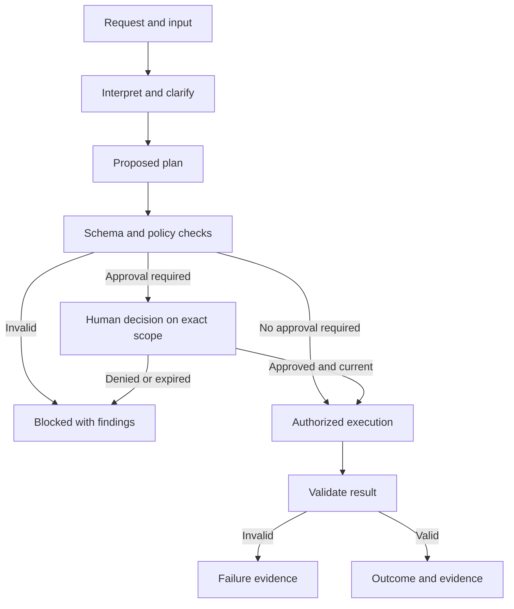
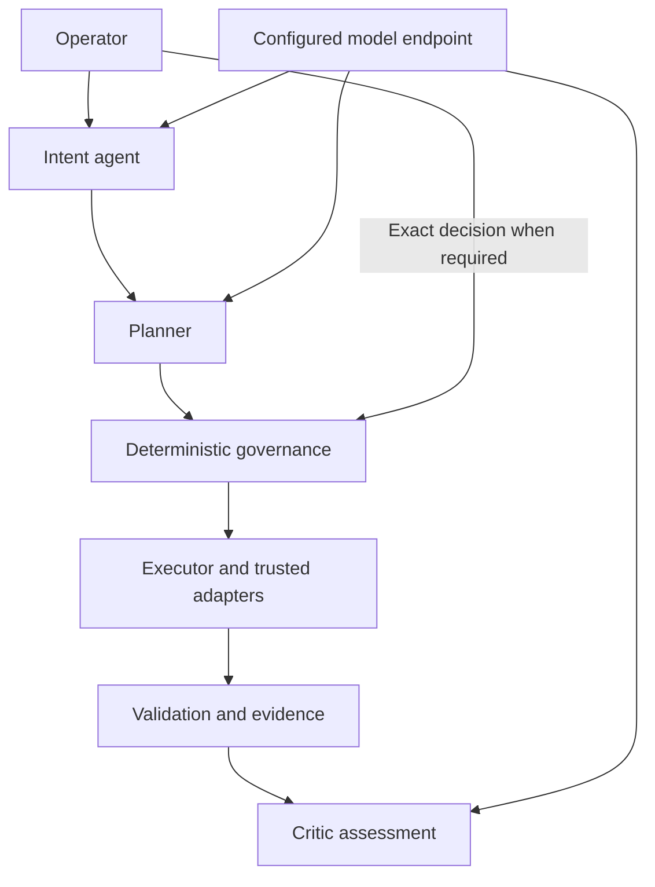

# ActionCharter

Table inspection reports now include recorded missingness, distinct/repeated values,
whole-row duplicate checks and basic numerical summaries when computed. Older runs
show their saved facts and identify unperformed checks; downloads never rerun data.
[Scope, limits and validation](docs/INSPECTION_QUALITY_REPORTS.md).

Workspace storage consolidation now covers workflow approvals, recipes, execution
evidence, reports/Critic records/local release evidence, write-policy state and governed
task history. Project ownership stays stable
across storage changes; references and session checks are preserved. Real
record migration remains unfinished; existing users need no storage changes.
[Storage scope and validation](docs/WORKSPACE_STORAGE.md).

Inspection filename questions now remain readable in the frontend and saved receipts.
Explicit read-only inspection requests accept `do/run/perform` and `on/of` wording.
[Behavior and validation](docs/INSPECTION_SOURCE_COMPATIBILITY.md).

[](https://github.com/wanggiya/action-charter/actions/workflows/test.yaml)
[](https://github.com/wanggiya/action-charter/actions/workflows/container-build.yaml)
[](LICENSE)
[](pyproject.toml)
[](https://codespaces.new/wanggiya/action-charter?quickstart=1)

**Local AI-assisted data workflows with explicit approval and verifiable results.**

The [shared task-actions layer](docs/TASK_ACTIONS.md) connects existing interface,
CLI, terminal chat and MCP actions to the same workflow services and saved evidence.
Public commands and authorization rules are unchanged; no new setup is required.

Its [shared composition boundaries](docs/TASK_ACTIONS.md#r5-shared-composition-and-evidence-boundaries)
also cover lazy CLI service delegation, explicit role-coordinator access, immutable
plan save and completed-run retrieval. These reuse existing services and preserve
saved formats; browsing a reusable method does not trigger run recovery or a model call.

[Shared execution primitives](docs/SHARED_EXECUTION_PRIMITIVES.md) give data and history
services common cancellation, graph and evidence contracts while preserving existing
workflow behavior and compatibility imports.

[Shared evidence services](docs/SHARED_CRITIC_EVIDENCE.md) let history and release
checks collect recorded observations and read Critic records without loading agent
behavior. Critic interpretation remains separate from execution authority.

The [trusted registry boundary](docs/TRUSTED_REGISTRY_BOUNDARY.md) separates current
operation metadata from package testing and execution. Existing installed operations
remain available; browsing them neither reinstalls packages nor grants permission.

[Storage repositories](docs/STORAGE_REPOSITORIES.md) separate operational metadata,
durable runs and saved-plan access from those services, using existing SQLite and
JSON formats. Existing workspaces require no new database or automatic migration.

[Specialized ledger contracts](docs/LEDGER_CONTRACTS.md) now give approvals, evidence,
lifecycle attempts, write-policy records and successful-workflow indexing shared
local persistence ports. Immutable records remain create-only; uncertain storage
never permits automatic replay. Existing files, SQLite layouts and authorization
checks stay compatible. No new setup or remote storage backend is introduced.

[Action context and local execution services](docs/EXECUTION_CONTEXT.md) connect those
boundaries to trusted owner/run identities, a separate audit trail and durable event
claims. Local policy admission still requires the existing exact approval checks.
Explicit duplicate events cannot repeat dispatch; history/catalog lookups retain pure
reads through bounded transient telemetry. Ordinary local use keeps its current
workflow and requires no new dependency or launcher setting.

The [shared metadata boundary](docs/STORAGE_REPOSITORIES.md#r3-transaction-and-plan-contracts)
now serves model settings, diagnostics and data views directly. Neutral plan contracts
preserve saved-plan bytes and hashes while removing storage dependencies on agent roles.

[Shared data access](docs/DATA_ACCESS_BOUNDARY.md) gives discovery and dataset services
the same bounded reader and fixed worker without depending on task-action internals.
Workflow decisions, source verification and exact authorization keep their existing checks.

The [frontend workspace split](docs/FRONTEND_WORKSPACES.md) gives Planner, Graph,
Results and Settings shared state and separate controllers/views while keeping the
current interface, saved-workflow restoration and backend authorization boundaries.

Future work is organized in the [active phase roadmap](context/PRODUCT_ROADMAP.md),
with detailed requirements linked separately. The [earlier roadmap](docs/development/ROADMAP_HISTORY.md)
is preserved as history; it does not override current implementation or authority.

The [development layer check](docs/IMPORT_LAYERS.md) now records existing dependency
boundaries and rejects regressions in the test suite. R6 moves existing implementations
under shared contracts, core, platform, data, capabilities and agent owners; the strict
check now finds no upward dependencies. Historical imports retain compatibility adapters.
[Architecture, evidence and post-R6 validation](docs/R6_COMPLETION_AND_ACCEPTANCE.md).
This requires no new runtime dependency or user setup.

The [CLI command modules](docs/CLI_COMMAND_STRUCTURE.md) now separate command groups
from app construction and registration. Existing `geoagent` commands, options, help,
outputs and terminal/frontend continuity remain; no new command prefixes are needed.

The [HTTP routers](docs/HTTP_ROUTER_STRUCTURE.md) separate request parsing, fixed route
dispatch and error responses from existing task coordinators. API URLs, saved records,
selected-model scope and exact authorization retain their current behavior. Manual
validation can now follow the [combined R-series guide](docs/R_SERIES_ACCEPTANCE.md); automated checks run per task.
The owner has confirmed startup, read-only CSV inspection and refresh/reopen recovery.
[Two manual checks remain](docs/R_SERIES_ACCEPTANCE.md#acceptance-record): Execution
History navigation and frontend/terminal continuity. Manual fresh-file writing is
optional; real workspace cutover remains separately approved work.

[Platform configuration](docs/PLATFORM_CONFIGURATION.md) now owns shared settings,
with one layout and lazy model/tool/client/replay views. Existing launch options,
environment names, Settings model preferences and exact write authorization remain.
No new configuration file or record migration is required.

Phase 0 [workspace storage](docs/WORKSPACE_STORAGE.md) now covers internal runtime
records, catalogs and historical lifecycle artifacts. Existing locations remain the
default until you explicitly use the offline migration tool. It copies and verifies
records, switches configuration, optionally archives old folders, and provides guarded
rollback. User input/output files and credentials stay in place. Existing users need no
new folder setup. Migration is an explicit offline owner action, not a launcher step.
The [closeout record](docs/P0_CLOSEOUT.md) distinguishes verified source-only storage
from historical migration rehearsals; the development checkout has now been adopted.

Phase 1 [benchmarks](docs/BENCHMARKS.md) now include a process-bounded runner,
CLI, deterministic evidence checks and [27 task definitions](benchmarks/README.md).
Start with `.venv/bin/geoagent benchmark run --fixture --task s-csv-profile-001`.
The full suite tests existing tabular/statistical/spatial skills and governance;
positive synthetic writes and disposable databases require separate CLI opt-ins
plus normal exact backend authorization. Results remain in workspace state, and
expected answers stay out of prompts. [B5 baseline evidence](benchmarks/results/README.md)
now records fixture and real qwen3.5:9b runs: 23 fixture passes versus 8 real-model
passes, 11 failures and 4 timeouts (both retain 1 skip/3 gaps). Critic review did not
complete on the real model. These are measured limits, not release readiness.
`benchmark report RUN_ID` renders saved metadata without execution; the four-task
offline CI gate runs with `python scripts/benchmark_ci.py`. Provider profiles and
egress controls remain unfinished.

[Compatibility consolidation](docs/R11_COMPATIBILITY.md) removes 290 obsolete
adapters and directs maintained callers to native services. The 117 documented
public/schema/generated-SDK boundaries preserve existing supported contracts.
Agent roles, workflow controls and exact authorization retain their behavior.
Use the [combined R-series acceptance guide](docs/R_SERIES_ACCEPTANCE.md) after
the automated gates; it records the owner's overall acceptance of merged PR #82.

Saved records and Advanced keep valid recipes/plans available when an individual
stored record is malformed or fails validation. Unavailable records show bounded
reasons and cannot be opened for approval or execution. Listing never repairs or
deletes the stored files; exact approval and execution validation remain strict.
See [Phase 0 closeout and validation](docs/P0_CLOSEOUT.md).

Optional [stable project identity](docs/PROJECT_IDENTITY.md) binds local ownership
to a project UUID after explicit offline adoption. Verified filesystem renames retain
identity and audit claims; copied markers/state fail closed. Existing projects need
no change. Cross-filesystem source transfers and container aliases require future
provisioning; they are not implied by local workspace adoption.

Metadata follow-ups such as `inspect it again` use the active workflow input; absent or
ambiguous sources prompt a question. Inspector/source mismatches are rejected before
execution. [Scope and validation](docs/INSPECTION_SOURCE_COMPATIBILITY.md).

Simple requests such as `Run a new read-only inspection of sample_orders.csv` now use
the existing exact metadata planner. Inspect-on-send controls whether they execute;
planning needs no model call, and optional Critic review remains separate.

The Planner can propose source-bound analysis goals from a recorded inspection, with
actual candidate fields, prerequisites and supported/missing methods. Outcome → Overview
→ **Let Planner propose analysis goals** opens suggestions; **Prepare this goal** plans
without executing. New reports distinguish computed and uncomputed statistical metrics.
[Scope, metric limits and validation](docs/ANALYSIS_GOALS_AND_REPORT_COVERAGE.md).

Execution and standalone Critic review now have separate diagnostic labels/statuses.
Settings → Model service exposes the review timeout; its default remains 15 seconds.
A review timeout preserves recorded execution results and never retries work.

Requests now keep content-free diagnostics for successes and failures: model/phase,
time, request size, reported tokens and sampled API RAM/CPU. Open **Request diagnostics**
in the Planner panel (also directly from a failed request), export sanitized JSON,
or use terminal `/diagnostics`. Numeric-summary inspections use focused instructions. Unknown
model/worker/GPU memory remains unknown; opening records never retries execution.
[Measurements, privacy, limits and validation](docs/REQUEST_DIAGNOSTICS.md).
Reasoning effort is now selectable in Settings → Model service and saved per project;
new requests use it without a launcher restart. Inspection reports use Outcome Report,
without an extra legacy evidence-file operation or internal task-ID entry.

Analytical inspections now produce a source-bound **Data readiness and findings** report:
field coverage, missingness, requested key/duplicate checks, codebook coverage and group
percentages. Outcome -> Report exports Markdown/PDF; CLI/MCP share the structured evidence.
Unknown checks and report omissions are explicit. Full supplied files remain the target;
sample substitution is blocked in the exploration loop. [Structure and full-data test](docs/READINESS_ASSESSMENT_AND_FULL_DATA_TEST.md).
Quality-only planning uses concise table-inspection instructions; timeout diagnostics
identify the active profile. Message size and full-file processing limits are separate.

Qualified CSV preparation now supports full-file streaming (200,000 rows / 64 MiB
output), typed PostgreSQL mapping preflight, per-column null policies and verified
create-only import/export. Saved analytical/technical handoffs expose actual schema
and receipts through Outcome Report, CLI and MCP. Joins/calculations retain their
separate bounds. Local-model advisory review reliability remains open.
[Scope and full-data/JSON/PDF validation](docs/FULL_DATA_WORKFLOW_ACCEPTANCE.md).

Table readers now feed one typed, bounded inspection pipeline. A shared catalog drives
reader discovery/policy and relevant Planner metadata; MCP `list_operation_contracts`
exposes the same registry. New results retain original source identity in an additive
descriptor; saved results stay compatible. [Structure, limits and validation](docs/TABLE_SOURCE_CONSOLIDATION.md).

Table inspection/statistics now reads **XLSX, flat JSON, JSON Lines and NDJSON** through
the existing operation and shared CLI/MCP service. Worksheet/header/range selection is
explicit; formulas and nested records are not executed or silently flattened. Statistics
adds recorded grouped-mean figures, correlation heatmaps and local PDF figures, with
advisory agent assessment beside the results. [Support, limits and combined validation](docs/TABLE_FORMATS_AND_STATISTICAL_FIGURES.md).

Initial CSV inspection now suggests statistical fields and cautions in Outcome →
Overview. **Ask Planner about these fields** explains recorded candidates while
preserving the workflow. [Field guidance and validation](docs/INITIAL_FIELD_GUIDANCE.md).
**Prepare a descriptive analysis** lets you choose a complete numerical candidate and
optional grouping field, then prepares a Planner request. Review the proposed workflow
and click Execute; initial hints never silently calculate statistics.
The Planner can now recommend next analyses from recorded field evidence, while
reports separate analysis definition and computed findings. Critic guidance reviews
scope and assumptions. [T05 behavior and validation](docs/T05_ANALYTICAL_ADVICE_AND_REVIEW.md).

CSV agents now have typed descriptive/grouped statistics, Pearson/Spearman matrices
and numeric OLS (coefficients, standard errors, P-values, intervals and R-squared).
Shared workflow/MCP/CLI services produce source-linked reports in Outcome → Statistics.
Statistics has readable page tabs and Markdown/PDF download selection. New reports
include structured tables and covariance matrices using the same recorded evidence.
See [pages, exports and validation](docs/STATISTICS_PAGES_AND_REPORTS.md).
See [setup, limits and exact validation steps](docs/TABLE_STATISTICS_ACCEPTANCE.md).
This is an initial statistical family, not causal inference or arbitrary Python execution.

CSV inspection Outcome now exposes **Groups** for two-field cross-tabs: choose
**Rows (vertical)** and **Columns (horizontal)**, then **Run analysis**. Age × gender
counts and percentages cover all matching records; every cell was reconciled against
the 5,000-row sample in browser acceptance. See [validation steps](docs/DIABETES_REAL_TEST_FLOW.md#age-by-gender-cross-tab--2026-10-27).
Grouped result titles follow applied fields. Shared group charts show explicit percentage
denominators on 0–100% axes in a bounded display area; changing display controls adds no model call.
Choose Compact/Comfortable/Large sizing or optional **3D columns** for two-field groups;
rotation and exact-value inspection use recorded results. Disabled Execute explains its state.
Saved-run recovery now matches the exact chat and plan beyond the recent global inventory;
terminal `/run` can reopen that matching run without an ID. Reads never retry execution.

[Implementation to-do list](docs/IMPLEMENTATION_TODO.md) consolidates the next work,
dependencies, existing foundations and acceptance gates. It is a plan, not delivered support.

[Planned statistical and format expansion](docs/DATA_SCIENCE_FORMATS_MEMORY_AND_REMOTE_PLAN.md)
records broader analytical reporting, document/image/point-cloud adapters, and memory
before autonomous Linux operation. These are requirements, not current capability claims.

[Planned generalization and consolidation](docs/GENERALIZATION_AND_CONSOLIDATION_PLAN.md)
records the direction for reusable skills, shared data contracts and simpler agent
coordination. This is a design record, not a claim that the proposed capabilities exist.
The [Builder reuse plan](docs/BUILDER_REUSE_AND_CAPABILITY_INTEGRATION.md) distinguishes
existing extension-code generation from proposed task-driven analytical skill acquisition.

[Manual task agent modes](docs/TASK_AGENT_MODES.md): choose Single agent or Three
agents in the conversation gear menu. Both share governed execution and saved
reports; three mode uses sequential Planner/Executor/Critic contexts, single mode
uses one context with explicitly labeled self-review. Automatic routing is deferred.

[Real diabetes test flow](docs/DIABETES_REAL_TEST_FLOW.md) provides copyable frontend
requests, measured expected results and the sample → preparation → database → export
acceptance sequence. The supplied 5,000-row sample is the first rows, not a random sample.

[Governed PostgreSQL workflows](docs/POSTGRES_DATA_WORKFLOW.md) now add ordinary-table
discovery/inspection, authorized create-only CSV import/export and exact-key soft
delete/restore. Existing PostGIS skills remain separate. Verified disposable-fixture
coverage and practical limits are documented; no unrestricted SQL or administration.

Two-field Outcome groups support cross-tab counts, percentages, totals and swapped
axes, shared with the terminal. [Validation and next data-workflow steps](docs/REAL_DATA_NEXT_TARGETS.md#cross-tab-delivered-slice-and-durable-next-steps--2026-10-26).

[Persistent terminal and workflow history](docs/TERMINAL_AND_CHAT_HISTORY.md): with the
normal launcher running, use `./actioncharter` for the independent terminal workspace
(`--plain` for limited terminals). Type messages, select chats, inspect outcomes/history,
and use explicit governed execution controls. Frontend Workflow history opens saved
versions read-only; continuing creates a new draft revision without historical authority.


Outcome opens across the main graph area; Flow graph returns to the workflow. Recorded
Columns supports individual field details, category frequencies/percentages and numerical
statistics where applicable. Terminal `/chart age` and `/chart groups total` show saved
text charts. See the [real-data target matrix](docs/REAL_DATA_NEXT_TARGETS.md) for the
next science/engineering acceptance tasks and remaining capabilities.

Describe a task, inspect the proposed steps, and run supported operations through a governed backend. Models help interpret requests and assess evidence; deterministic software checks scope, permissions and results. The interface and CLI use the same backend contracts.

Narrow single-file metadata inspection requests reject unrelated operations before saving a proposal; broader task coverage remains model-dependent. [Inspection on send](docs/development/checkpoints/CHECKPOINT28_2_INSPECTION_SUBMIT.md) adds an explicit, default-OFF composer setting: eligible local CSV, vector or raster metadata inspections can run on send within fixed batch limits. Other proposals retain Execute; writes retain Allow writes → Authorize → Execute.

[Comprehensive CSV/TSV exploration](docs/COMPREHENSIVE_INSPECTION_DELIVERY.md) now
profiles every field with observed types, candidate roles, appropriate full-file statistics,
missing-marker counts and codebook-aware categories. Recorded analytical graphs progress
left to right; their Outcome opens resizable Overview, Columns, Table, Chart, Groups and
Checks views. Raw previews remain bounded and separate from complete-file summaries.
The shared `profile_dataset` MCP tool and `profile-dataset` CLI use the same contract.
[Interactive selection](docs/COMPREHENSIVE_INSPECTION_DELIVERY.md#interactive-selected-columns-and-grouped-percentages--2026-10-25)
adds age-only or combined-field tables/groups, explicit full-file reads, percentages
of all matching rows or within a group, and shared saved selections through `chat explore`.

[Frontend/CLI continuity](docs/COMPREHENSIVE_INSPECTION_DELIVERY.md#frontend--cli-continuity--2026-10-25):
with the normal launcher running, use `.venv/bin/python -m geoagent_harness.cli chat list`,
`chat show ID`, `chat send "message" --chat ID`, and `chat result ID --view columns`.
Both interfaces share the API's chat, proposal, analysis and model settings. Refresh saved
chat in Planner to load CLI changes. Recorded views need no model call or rescan.

The default comprehensive analytical runtime is a dedicated Docker worker: selected-file
read-only mounts, no network/secrets, non-root, private bounded scratch and recorded image
identity. Build it once with `bash scripts/build_analytical_worker.sh`, then use the existing
`bash scripts/start_actioncharter.sh` launcher. No write flag is needed for read-only
exploration. Existing metadata, transformations and specialized duplicate checks retain
their existing runtimes. Docker absence fails explicitly; there is no silent host fallback.
See the [delivery and validation guide](docs/COMPREHENSIVE_INSPECTION_DELIVERY.md) for
exact prompts, resource limits, trusted compatibility mode and remaining work.

[Recorded analytical graphs](docs/ANALYTICAL_GRAPH_AND_INSPECTOR.md) show saved input
files, actual analytical actions and findings. Click a block for source identity,
strategy, row coverage and computed statistics in the information panel. Saved chats
restore this read-only view without repeating analysis; executable plans remain separate.

[Analytical conversation](docs/BOUNDED_ANALYTICAL_LOOP.md) can discover one input
folder, assess operation-specific limits, request bounded CSV profiles and explain recorded
findings with saved evidence. Ask “Explore the data in data/input/test …”. Read-only tools
preserve the workflow; samples remain provenance-unverified. Model failures retain partial
findings. Sampling writes, statistical fitting and flexible multi-agent deployment remain
follow-ups, not current capabilities.

Complete supported profile requests use model-free planning. The frontend checks the
running API's analytical-routing revision before profile submission; restart the launcher
and refresh after updating. Refresh restores saved work and reconciles submission status;
it does not retry a failed model call. [Recovery details](docs/TABLE_EXPLORER_ACCEPTANCE.md#profile-timeout-and-refresh-recovery--2026-10-24).

[Columns and Explore](docs/TABLE_EXPLORER_ACCEPTANCE.md) add searchable field quality,
explicit exact repetition/duplicate checks and interactive full-source grouping with
distinct counts, numeric summaries, filters and charts. These controls need no model
call; MCP and CLI use the same typed services. Relationship statistics and adjusted
models remain planned, and exploratory views are not yet durable saved workflows.

[Full-file analytical inspection](docs/ANALYTICAL_INSPECTION_ACCEPTANCE.md) adds
sectioned CSV codebooks, complete-source profiles/distinct counts/group summaries,
verified filtered pages and explicit streaming aggregate exports. Settings can discover
installed Ollama models and persist a selection for new API requests without restarting.
Optional bounded execution assistance explains recorded evidence; it grants no execution
or write authority. The real diabetes fixture passed temporary-project acceptance;
other CSV transforms retain their existing size limits. See the guide for exact prompts
and current bounds.

Supported domains now include bounded pandas-backed CSV processing and geospatial data: vector and raster inspection/conversion, PostGIS workflows and bounded GeoServer inspection/publication. Local Ollama is supported through an OpenAI-compatible model endpoint.

PostGIS promotion and rollback share a [governed lifecycle](docs/POSTGIS_LIFECYCLE.md)
with separate exact decisions, durable attempt records and independent verification.
Existing CLI formats and historical evidence remain compatible.

[Vector-first spatial exploration](docs/development/checkpoints/CHECKPOINT28_3_SPATIAL_VIEWS.md) adds explicit source-verified layer selection, display reprojection and linked attributes, followed by bounded raster grayscale/color/RGB/class views with NoData and exact pixel inspection. Planner can select recorded layers/bands/render settings conversationally and request backend-formatted explanations of saved facts. Exact recorded count/dimension questions need no model call or source reread. Viewing does not authorize or execute processing; preview limits remain visible.

[Typed result exploration — 28.3](docs/development/checkpoints/CHECKPOINT28_3_RESULTS.md) adds complete bounded CSV filtering/sorting/paging, column profiles and filtered chart totals. Planner can propose a scoped recorded-result view without replacing or executing the workflow; normal view reopening uses saved snapshots.

Selected workflow operations now show their recorded formula, input/output paths,
bounded table preview and readable validation checks in the information panel.
Results restore only for the matching chat and plan; drafts show no inherited
execution evidence. [Recorded-result validation guide](docs/development/checkpoints/CHECKPOINT27_RECORDED_RESULTS.md).
[Recorded visualizations](docs/development/checkpoints/CHECKPOINT27_VISUALIZATION.md) began with bar/scatter and point previews. [Analysis and layout delivery](docs/development/checkpoints/CHECKPOINT27_ANALYSIS_AND_LAYOUT.md) adds ten chart views (including pie/donut), explicit hash-verified full-CSV grouping, and bounded WGS84 points, lines, polygons/holes and attributes. Ordinary viewing uses recorded snapshots; analysis requires an explicit read. No tiles or live database queries are implied.
The [Results workspace](docs/development/checkpoints/CHECKPOINT27_RESULTS_WORKSPACE.md) opens through Outcome or View output, with connected Overview/Table/Map/Chart/Checks page tabs, a visible resize divider and expansion. Tables search/sort/page loaded rows; point/table selections link. Load verified CSV explicitly checks the recorded artifact hash for a larger bounded preview; ordinary viewing uses saved snapshots.

[Checkpoint 27 technical acceptance](docs/development/checkpoints/CHECKPOINT27_EVALUATION.md): 1,825 tests and six correct local-model fixture executions in the final profile. Optional Critic assessment timed out in all six; broader model reliability and the pre-demo capability/learning/memory gates remain explicit limitations.

**Status: single-operator alpha.** Existing recipe workflows can execute through the interface. Planner agent now offers exact-scope execution for supported inspection and recipe workflows. The separate Context & intent journey still has integration limits. This is not yet a packaged desktop app or a hardened multi-user service.

[Optional capability acquisition — 28.1 pilot](docs/development/checkpoints/CHECKPOINT28_1.md) adds a default-OFF per-chat switch. Planner can propose a closed CSV text-cleaning adapter, the backend tests synthetic/held-out cases, and Critic assesses applicability. One explicit install action registers the exact tested definition and asks Planner for a normal workflow. Installation grants no write or execution authority. This is a restricted data-only adapter family, not arbitrary Python generation, RL or general library-function execution. Linux resource-bounded testing currently requires the existing pinned pandas runtime. [Text-normalization example](examples/text-normalization/README.md). The bounded OFF/ON/changed-input-reuse local-model trial passed; this is not general model reliability or demonstrated speedup. See the delivery guide for prior failures, exact bounds and acceptance.

Planner chat retains its full transcript while sending bounded recent excerpts to the model. Previous-message context can be disabled without deleting history; the current workflow remains explicit context. Conversational Planner requests structural JSON-schema output and keeps full backend validation. Model errors distinguish malformed output, reported token truncation, timeout and configuration failures; [format compatibility and diagnostics](docs/PLANNER_STRUCTURED_OUTPUT.md). Supported Ollama models can optionally use `MODEL_REASONING_EFFORT=none` to test non-thinking generation; it is not a guaranteed timeout fix. Planned input-file nodes and inspector source paths show declared data scope. Existing saved workflow scope recovers on startup without model calls or execution. Planner reuse citations are constrained to supplied or successfully inspected sources; ordinary planning needs no recipe selection. Explicit calculated-column requests receive a narrow missing-operation check with one correction and simple single-column requests use a decoder operation skeleton; summaries alone do not establish calculation support. The information panel lists actual workflow operations and calculation formulas; raw arguments, execution details, evidence and task history expand on demand. Per-chat graph positions persist in this browser and new blocks seek free space. Desktop Planner/information panels resize; outcomes and workflow-source groups expand/collapse without execution. See [conversation context guidance](context/CURRENT_STATUS.md#planner-and-execution).

Saved history uses chat bubbles. History/context controls collapse together to save room, and a drag handle resizes the message-writing area. Planner labels distinguish **Saved chat history** from **Context sent to Planner**. The single **Chat memory** switch controls recent-message inclusion. OFF keeps the saved transcript and current workflow. Its preference stays the same across chats and refreshes in this browser. Settings’ Include private declarations switch is also remembered. The disclosure separates your next request from the actual last-completed-request receipt. Other conversations are not pooled into chat context. **Cross-chat memory is deferred until checkpoint 30 or later**, after intervening operational/privacy work and a fresh operator decision; see [deferred scope](docs/DEFERRED_CROSS_CHAT_MEMORY.md).

The [post-calculation delivery plan](docs/POST_CALCULATION_DELIVERY_PLAN.md) separates remaining result-panel/evaluation work from proposed bounded capability acquisition, optional learning-policy experiments and private domain knowledge. General generated-code acquisition and RL/model training are not implemented. Planned [capability acquisition](docs/OPTIONAL_CAPABILITY_ACQUISITION_PLAN.md) is optional, OFF by default and task-scoped: use existing operations/recipes first, propose a bounded addition only for a demonstrated gap, and reuse accepted installed versions. This switch would not authorize installation or execution. [Runtime write controls and acceptance](docs/development/checkpoints/CHECKPOINT27_RUNTIME_WRITES.md) describe the implemented checkpoint 27.7 slice and its limitations. The warning-labelled Allow writes switch beside Authorize/Execute and Settings share session write availability without routine restarts; exact authorization remains required and overwrite stays separate. [Conservative report authorization](docs/development/checkpoints/CHECKPOINT27_AUTHORIZATION_FIX.md) now retains plan gates for evidence-only recipes; approving still performs no operation. The operator requires generated capabilities, the learning/RL pilot and advanced private memory to be implemented and validated before demo or real-data testing; those gates remain unfinished.

Execution History lists saved workflow runs by input filename, operation and time at the top. Choose **View outcome** to reopen saved evidence without replacing the current workflow or executing it. Cancellation/recovery controls remain accessible from the same section.

[Discovery consolidation](docs/development/checkpoints/CHECKPOINT28_DISCOVERY_RESTRUCTURE.md) records the baseline, revised target and delivery. CSV inspection streams preliminary characteristics, full row/missing counts and SHA-256 without a dataframe. TIFF, closed GeoPackage and Shapefile discovery reads driver metadata then streams a package hash without loading pixels or geometry tables. Guards are 1 GiB / 120 seconds per reader; synthetic CSV/TIFF measurements cover 16/64 MiB, not arbitrary real-world scale. GeoJSON, transformations and spatial displays retain separate limits. [Checkpoint 28 acceptance](docs/development/checkpoints/CHECKPOINT28_CLOSEOUT.md) and [work resume](context/WORK_RESUME.md) distinguish engineering delivery from unfinished learning/private-knowledge and demo gates.

Exact supported Inspect requests now prepare workflows without model calls through
durable submissions. Inspect on send OFF only prepares; ON permits eligible local
reads, including 1–4 distinct sources with a 1 GiB aggregate budget. For mixed
formats use `Inspect sample_orders.csv and sample_dem.tif. Return metadata. No writes.`
Outcome selects each recorded operation. Broader/ambiguous requests retain Planner;
writes retain their exact controls. CLI `submit-inspection` shares this coordinator
(preparation by default; `--execute` for permitted reads). CLI `discover-dataset`
and MCP `discover_dataset` share the bounded discovery service. Legacy inspector
contracts remain compatible. Restart/refresh for submission revision `inspection-batch-v5`.

[Inspection expansion](docs/INSPECTION_ON_SEND_EXPANSION.md) supports bounded single-dataset CSV/TSV, GeoJSON, GeoPackage, closed Shapefile and self-contained GeoTIFF inspections on Linux. Multi-step and service inspections remain on Execute.

Raster Outcome Overview now includes readable extent, resolution, data types and
NoData, with expandable technical metadata: CRS WKT, compression/layout, per-band
blocks, color interpretation, units, scale/offset, stored tags and band-1 overview
dimensions. Metadata is bounded and does not compute pixel statistics/histograms.
Map opacity shows endpoints and its current percentage; the reported endpoint
fault has not been reproduced in mouse/keyboard checks. See the discovery guide
for current limits and validation.

[Learning without RL](docs/LEARNING_WITHOUT_RL.md) records the next evaluated reuse/retrieval direction. Existing outcome ranking is experimental; no model training or general learning benefit is claimed.

## Why ActionCharter?

**Reusable recipes and durable runs:** Describe a task in Planner chat; recipes expand into editable, validated operations. Planner also drafts reusable recipes, isolated fixtures test them, and Critic reviews the candidate before optional registration. Execution engine records durable steps, cancellation and conservative recovery; Critic assesses recorded outcomes without changing deterministic status. No separate Builder is needed for this journey. [Checkpoint 26 closeout and validation](docs/development/checkpoints/CHECKPOINT26_CLOSEOUT.md). Transactional resume, parallel execution and indexed/cross-chat memory remain deferred.

The graph now shows a secondary [Critic review · advisory](docs/development/checkpoints/CHECKPOINT27_CRITIC_GRAPH.md) branch for requested recorded assessments. Select it for findings, limitations and run provenance; review status stays separate from execution and deterministic validation. Opening or refreshing it never repeats execution or assessment. During development, editing a plain TypeScript hook reloads the page to avoid stale React hook state; saved chats/workflows restore, while unsaved UI edits may reset.

**Each conversation is one task with private memory.** Keep geospatial and CSV work in the same chat: its transcript and latest validated plan persist when the topic changes. New chat starts separately; opening an older conversation restores that conversation's own state. No task selector or cross-chat memory sharing is required. Local SQLite adds no dependency or background agent. See [conversation acceptance](docs/development/checkpoints/CHECKPOINT26_CONVERSATIONS.md). Indexed core facts, automatic summaries and corrections remain planned single-conversation work. The normal UI uses saved chat/workflow context only: opening a chat automatically restores its latest validated workflow, without a model call or manual plan selection. An experimental **Automatic method notes** Settings switch enables a separate helper: one bounded request after a changed validated workflow, then cached machine-generated/unvalidated advice for later requests in that chat. It is OFF by default, adds no container/model and requires no manual method-management steps. Opening a chat still makes no model call. [Behavior, limits and frontend acceptance](docs/METHOD_MEMORY_HELPER_DESIGN.md#first-integration--implemented-experimental-scope) distinguish this workflow-only slice from future evidence learning/corrections. Cross-chat sharing remains deferred. See [scope, limitations and manual acceptance](docs/METHOD_MEMORY_PROTOTYPE.md). Memory never grants execution authority. Calculation planning recognizes “multiplied/divided” wording and includes a complete non-executing workflow example. Repeated schema-repair deferrals identify model-output failure without requesting technical authorization rules. Planner schema-repair permission deferrals receive one correction; repeated deferrals report failure without replacing a saved workflow. See [architecture](docs/PROJECT_MEMORY_ARCHITECTURE.md).

Giving a model access to a powerful tool is easy. The harder problem is proving
that an AI-assisted operation:

1. used the correct input;
2. selected an allowed operation;
3. remained inside an explicitly bounded scope;
4. received approval for the exact consequential steps;
5. executed only what was approved;
6. produced a valid result;
7. was independently verified; and
8. left evidence that can be inspected later.

Generated text never becomes authority merely because a model generated it.
ActionCharter turns an uncertain proposal into a chain of typed, digest-bound,
and independently checkable artifacts.

## What you can do

| Capability | Current behavior |
|---|---|
| Describe and clarify a task | Intent reasoning supports fresh requests or explicitly reviewed historical context |
| Inspect a plan | Typed steps, input scope and policy checks; graph and evidence inspection |
| Process tabular data | Inspect CSV/TSV, select/filter, fill/drop missing values, join, aggregate and export fresh CSV artifacts with bounded previews and exact approval; [checkpoint 24 examples](docs/development/checkpoints/CHECKPOINT24.md) |
| Calculate table columns | Typed arithmetic, comparisons and numeric conditionals; formula controls, explicit missing policy, bounded effort and independently checked fresh CSV outputs. [Behavior and testing](docs/BOUNDED_CALCULATIONS.md) |
| Combine spatial and tabular data | Inspect GeoJSON and extract flat attributes into validated CSV intermediates; geometry is deliberately omitted |
| Process spatial data | Registered vector/raster capabilities and governed PostGIS operations |
| Review and run recipes | Exact-scope decisions, bounded execution, validation and durable attempt records |
| Inspect results | Evidence, reports, independent checks and Critic assessment |
| Prepare reproducible workflows | Governed Snakemake export with static validation; export alone does not execute replay |
| Discover library capabilities | Installed Python package inventory and bounded static function/class/method discovery, searchable in Settings and CLI; candidates grant no authority |
| Develop extensions | Shared operation contracts, tested data-only CSV adapter packages and the existing Builder lifecycle; [checkpoint 25 guide](docs/development/checkpoints/CHECKPOINT25.md) |

CLI coverage is broader than the current interface. See [interface/CLI coverage](docs/INTERFACE_CLI_PARITY.md) and [current implementation status](context/CURRENT_STATUS.md).

## How work moves through the system



This diagram describes the backend authority model. It does not imply every plan shape has a complete interface route today. The legacy Intent/technical compiler still requires its separate continuation; current saved inspection plans can use the direct Execute review. Reviewed context, a stored plan and a success claim each remain distinct from execution permission.

## Agents and responsibilities



| Role | Responsibility | Authority boundary |
|---|---|---|
| Intent | Clarify the objective and explicit inputs | Cannot approve work or call processing tools |
| Planner | Compose/revise workflows and draft reusable recipes with fixtures | Cannot execute or grant permission |
| Execution engine | Deterministically dispatch supported, authorized operations | Cannot invent tools or use model output as authority |
| Critic | Assess checked evidence and reusable-recipe fixture findings | Cannot override deterministic status or create run authority |
| Builder · legacy extension path | Propose extension candidates; not used for normal recipe authoring | Proposals stay untrusted; tests/review do not grant execution authority |
| Method helper · experimental opt-in | Cached procedure notes from changed validated workflows | Unvalidated advice; no execution evidence, tools, sharing or authority |
| Operator | Review intent and make exact work decisions | A decision does not cover changed scope |

Governance and verification are software controls, not additional reasoning agents. Credentials remain behind the tool boundary.

## Start locally

The reference development environment is **Ubuntu 24.04 on WSL2**. Use Linux Python and Node inside WSL; mixing Windows executables with WSL paths can break installation.

Requirements: Python 3.11+, Linux Node.js 22.12+ and pnpm 10.17.1. Docker Compose is needed for container validation and containerized services. The lightweight agent image can show CLI help, inspect agent manifests and validate the recipe catalog without loading optional GIS libraries; GIS execution requires its GIS runtime. Ollama, PostGIS and GeoServer are needed only for their related actions; the launcher reports availability without starting them.

```bash
git clone https://github.com/wanggiya/action-charter.git
cd action-charter
make install
corepack pnpm@10.17.1 --dir interface install --frozen-lockfile
make inspect
```

`make inspect` reads the included `data/input/sample_points.geojson` and returns structured metadata without changing the dataset or loading it into a database. You can run the same check directly:

```bash
.venv/bin/geoagent inspect-vector data/input/sample_points.geojson --pretty
```

For model-assisted actions, configure the endpoint in the same terminal before starting. This example is for Ollama reachable from WSL on localhost; set the name to a model you actually installed:

```bash
export MODEL_BASE_URL=http://127.0.0.1:11434/v1
export MODEL_NAME=qwen3:4b-instruct
export MODEL_TIMEOUT_SECONDS=300
export MODEL_MAX_TOKENS=4096
make interface-start
```

Open **http://127.0.0.1:5173**. One launcher starts the loopback API and frontend; one Ctrl+C stops both. It does not install dependencies, start containers or enable execution by default. Model latency and plan quality depend on the configured model and machine. Set exports in the same launch terminal; the running API does not inherit later exports. See [model troubleshooting](docs/MODEL_TROUBLESHOOTING.md).

To deliberately enable the existing bounded execution actions for reviewed local work:

```bash
bash scripts/start_actioncharter.sh --enable-write-tools
```

The host launcher reads allowlisted non-secret settings from the project `.env`, including the database name/user, model and allowed scopes. Existing terminal exports take precedence. Container service defaults are translated to host loopback addresses, and local secret files default to `.secrets/postgis_password` and `.secrets/geoserver_password`. Password contents are never exported or sent to the browser. Relative secret-file paths resolve from the project root. `.env` cannot enable writes or overwrite; the launcher flag controls writes.

This startup option does not approve a workflow. Required scope review, approval, policy and validation checks still apply. Overwrite remains disabled. Containers use different network addresses from a host-side WSL process; configure service endpoints for the environment in which the backend runs.

For frontend-specific development, see [interface setup](interface/README.md), [WSL setup](docs/WSL_FRONTEND_SETUP.md) and [API troubleshooting](docs/INTERFACE_API_TROUBLESHOOTING.md). For browser-based remote development, see [remote development](docs/REMOTE_DEVELOPMENT.md).

## Using the interface

- **Task workspace:** select a project input, describe or clarify a task, optionally select history, review intent and generate a supported inspection plan.
- **Planner agent:** discuss files and workflow changes in a recoverable conversation beside the graph. Validated revisions are automatically stored; clarification and failed replies preserve the current plan. Bare input filenames resolve under `data/input`; safe normalized relative paths remain supported. Switching views retains the current plan.
- **Snakemake workflow blocks:** add Export to Snakemake and its verification directly to a completed saved workflow, or ask Planner to append them. The source run is reused without reloading PostGIS. See [the frontend block walkthrough](docs/WORKFLOW_SNAKEMAKE_BLOCKS.md).
- **Flow graph:** inspect the current proposal or recorded plans, recipes and runs. Viewing a graph does not run it. Mouse-wheel zoom follows the pointer; Shift+wheel pans horizontally. Node movement and zoom are presentation-only.
- **Authorize / Execute:** orange Authorize highlights required graph operations and records exact approval without running them. Yellow Play/Execute runs the reviewed scope; read-only inspections need no approval checkbox. Review, history and outcomes occupy a right-side panel beside the graph.
- **Execution History:** browse durable inspection and recipe attempts; open Workflow runs for cancellation, per-step previews and recovery.
- **Reusable recipes:** describe a task in Planner or browse reusable subworkflows; optionally register tested candidates through Planner, isolated fixtures and Critic.
- **Cancel:** stop later operations after the active operation and its verification finish. Completed outputs remain.
- **Outcome:** view the current execution result and evidence.
- **Saved records and Settings:** browse saved plans/recipes; select solid fill or Outline with subtle top/bottom tint and a transparent center on interface controls, graph blocks, timeline stages and information sections, with black/white filled text remembered in the browser; inspect model configuration and obtain launch-terminal recovery instructions.
- **Block actions:** Add/Delete/Move/Connect/Disconnect and Parameters are visible above the graph. Connections define operation prerequisites, with typed validation before saving/authorization/execution. Right-click and Shift+A open the add menu; Delete applies with canvas focus. Move changes layout only. Zoom/legend controls default to the lower-left.
- **Advanced:** Technical Plan, Task workspace, templates, recipes, task history, Assurance and separate presentation drafts. Presentation drafts remain non-executable.

The normal journey is being simplified to request → graph review → decision → run → outcome. The supported current-plan route combines review and execution controls; legacy and unsupported routes retain separate controls. Do not treat the proposed future experience as already delivered.

## Skills, recipes and workflows

| Term | Meaning | Example |
|---|---|---|
| Skill | One registered operation with typed arguments and policy | `inspect_vector` |
| Recipe | A reusable definition connecting supported skill steps | Inspect, convert and validate a dataset |
| Workflow/run | A concrete attempt with particular inputs, decisions and results | One conversion of a selected file to a fresh target |

Templates help create recipe proposals. They neither install skills nor grant approval. See [core concepts](docs/CORE_CONCEPTS.md).

## Checkpoint 27: successful-workflow retention

New durable runs automatically save eligible successful workflows as indexed method records, with no extra model call or registration. In **Reusable recipes**, use **Recipe list** for short summary rows or switch to **Keywords** to filter the list. Select a row for method details and expandable evidence; discussion shortcuts are secondary under More actions. Manual composition stays in Advanced, labelled Validate composition and open draft. Records are scoped to their originating chat; they grant no permission and are separate from generalized templates. Indexing failure preserves execution results and permits indexing-only retry. Legacy synchronous execution/Snakemake export and old runs without contract snapshots are outside this path. [Implementation and validation](docs/development/checkpoints/CHECKPOINT27_RETENTION.md).

[Planner-owned recipe discovery](docs/development/checkpoints/CHECKPOINT27_DISCOVERY.md) can search/inspect sanitized catalog structures and eligible own-chat examples, then propose an adaptation directly from ordinary conversation. Initial lookup needs no inference; optional discovery permits at most two extra read-only exchanges, with a maximum four Planner calls including final generation/correction. Browsing recipes is never required. CSV prompts carry focused schemas and report safe request/timing diagnostics; recipe lookup’s effect on local-model latency remains unbenchmarked; [B5](benchmarks/results/README.md) separately records task-baseline timings. The remaining [checkpoint 27 plan](docs/development/checkpoints/CHECKPOINT27_PLAN.md) covers optional Critic enrichment, bounded charts/maps and laptop evaluation before prototype/demo preparation. Existing Advanced controls remain available; this adds no cross-chat memory or new agent hierarchy.

## Verify your development environment

```bash
make test                 # Python offline tests
make interface-validate   # TypeScript checks and production build
make interface-check      # startup diagnostics; services must not occupy the chosen ports
make validate             # Python, frontend, launcher syntax and Compose checks
```

Use the [repeatable interface acceptance process](docs/INTERFACE_ACCEPTANCE.md) to prepare an isolated session, record bugs and retest fixes. `make interface-acceptance` copies current source and public fixtures without starting services or executing workflows.

Typechecking and building do not replace manual browser acceptance or a live end-to-end run. No component-test runner is currently declared as `pnpm test`.

## Documentation and repository map

| Location | What belongs there | Start here |
|---|---|---|
| Root README | Current overview, capabilities, setup and navigation | This page |
| `docs/` | How-to guides, operator procedures and developer references | [Documentation guide](docs/README.md) |
| `context/` | Concise project state, architecture, catalogs and decisions; selected files also enter agent prompts | [Context guide](context/README.md) |
| CHANGELOG | Human-readable record of behavior changes | [Change history](CHANGELOG.md) |
| `interface/README.md` | Frontend-specific setup and development | [Interface guide](interface/README.md) |
| `src/`, `agents/`, `tests/` | Implementation, trusted role manifests and automated checks | [Contributing](CONTRIBUTING.md) |
| `data/input`, `data/output` | Bounded input and generated output locations | Input remains separate from output |

Read [documentation responsibilities](docs/DOCUMENTATION_GUIDE.md) for the audience, update rules and historical-record policy. Development checkpoint records are kept out of the onboarding narrative and flow diagrams.

## Safety and current limits

Model output is untrusted. The backend checks registered capabilities, safe paths, digests, approval scope and validity. Required validation and verification establish success; confidence or generated text does not. Keep passwords in local secret files, and never commit secrets, private data or generated operational evidence. The GeoServer reference setup uses a dedicated test user and workspace; it does not require unrestricted administrative access for the agent.

Generalized long-term memory, exhaustive dynamic library discovery, unrestricted library-function execution, full CLI/interface parity and end-user packaging are not delivered. Bounded pandas processing and static library discovery are implemented; automatic successful-workflow retention is available for new durable runs; bounded Planner adaptation from own-chat records is implemented. Export static validation does not prove a successful Snakemake replay. See [security policy](SECURITY.md), [runtime boundaries](context/RUNTIME_BOUNDARIES.md) and [product roadmap](context/PRODUCT_ROADMAP.md).

## Contributing, compatibility and license

Read [CONTRIBUTING.md](CONTRIBUTING.md) before changing a contract or authority boundary. Report vulnerabilities through [SECURITY.md](SECURITY.md).

The Python distribution is `actioncharter`; the retained compatibility interfaces are the `geoagent_harness` package and `geoagent` / `geoagent-mcp` commands.

Created by **Jay Qi**. [Citation metadata](CITATION.cff). Licensed under [Apache License 2.0](LICENSE); see [NOTICE](NOTICE).

The **Planner agent** opens a conversation beside the graph. Send a task, answer clarifications, or request additions/removals to registered workflow operations. Skills below Send are optional: empty selection uses automatic choice, while selected chips persist across messages. Each turn records selected/workflow skills and shows changes. Completed conversations persist locally; reopen them with the conversation selector; their latest validated workflow opens automatically, including after refresh. Sending a message preserves the current workflow until its revision passes backend validation and proposal storage. Saving does not approve or execute it. See [frontend dialogue validation](docs/PLANNER_DIALOGUE_ACCEPTANCE.md) for the current manual test sequence.

Library discovery saves candidate metadata in `library-discovery/`; it does not register executable operations. Tested adapter installation persists in `operation-packages/` across launcher restarts. Reinstallation is unnecessary when reopening the same project. Settings uses the existing sliding ON/OFF switch for private declarations.

Saved scans can now be reopened in Settings under **Saved scanned libraries**, with expandable scan/library/function groups and paginated search. Scanned candidates remain non-executable. Information cards connect input → operation → planned/recorded result with arrows and declared dependencies. See the [functional example index](examples/README.md) rather than choosing examples by checkpoint number.

Planner troubleshooting: for a CSV-only acceptance test, select **Inspect CSV** alone (or leave skills unselected for automatic scope). “No PostgreSQL or PostGIS operations” is treated as an exclusion for descriptive schema scoping. An invalid-schema reply is rejected without saving or execution; a successful live retry still needs to be verified.

To extend a saved CSV inspection, ask “Keep the CSV inspection. Add a calculation creating doubled = amount * 2 for every row. Save the result to a fresh CSV under data/output. Do not use PostgreSQL or PostGIS.” Review both inspection and calculation, including the formula and source. Allow writes, Authorize and Execute remain separate actions.

If the same old Planner schema error persists after an update, stop and restart the launcher/API; refreshing Vite does not reload Python. Current error diagnostics include `contract: inspection-source-v2`; the updated frontend requires that exact loaded version before sending. Close the information Inspector with X to reclaim graph space; select a graph block to reopen it.

Before sending a Planner turn, the frontend checks `/api/v1/health` for `planner_contract_revision: inspection-source-v2`. An incompatible API blocks the model request and gives restart guidance. The API startup reports the same loaded revision and conversation-module path; the health endpoint is also available directly at http://127.0.0.1:8765/api/v1/health.

Chart inspection: click a bar, point, pie/donut slice or legend, line/area series, histogram bin, box plot or summary value for plotted-value details. Click elsewhere or press Escape to dismiss. Keyboard Enter/Space is supported. Details use the displayed snapshot/verified analysis and make no model or execution request.

[Checkpoint 28.2 outcome recommendations](docs/development/checkpoints/CHECKPOINT28_2.md) adds an optional default-OFF own-chat evidence selector. Conversation header gear groups Chat memory, capability preparation and recommendations. Verified current-contract checks can break recipe relevance ties and supply a bounded Planner shortlist; no model training or execution authority. The synthetic selector evaluation is limited; representative model benefit remains unproven.

Outcome recommendations remain visible while enabled, with guidance for empty evidence. Read-only inspection completion alone has no separate validation check; use a validated transformation and a follow-up request in the same chat to test evidence retrieval.

[28.2 execution and paired evaluation](docs/development/checkpoints/CHECKPOINT28_2_EVALUATION.md): normal read-only inspections use one Execute click with writes OFF. Writes retain Allow writes → Authorize → Execute, and fresh CSV output paths remain mandatory. A temporary six-case ON/OFF harness measures actual outputs and model cost; recommendation receipts distinguish supplied evidence from model use.

Planning follow-up: narrow CSV selection/filter coverage checks reject inspection-only substitutes; simple CSV and vector-to-table requests use typed source/dependency guides with automatic skill selection. Explicit fresh-output requests can refresh inherited occupied CSV proposal paths without changing existing files or granting overwrite authority. The paired model evaluation has not established a ranking benefit; see its delivery notes for failures and oracle limitations.

### Planned domain knowledge acquisition

The [domain knowledge design](docs/DOMAIN_KNOWLEDGE_ACQUISITION_DESIGN.md) records automatic capture of sourced dataset definitions, domain methods and processing preferences, with corrections and reusable recipes. Private single-chat validation comes first; project knowledge across chats and sanitized portable packages remain later gated work. This is a design, not a claim of reliable domain learning or model training.

[Next: checkpoint 29 private knowledge](docs/development/checkpoints/CHECKPOINT29_PRIVATE_KNOWLEDGE.md) is planned: sourced same-chat recall, corrections and bounded Planner context using existing agent roles. Cross-chat sharing and model training remain deferred; this plan adds no runtime memory behavior.

[Memory design proposal](docs/ROLE_MEMORY_AND_KNOWLEDGE_MANAGEMENT.md): role-specific notes, agent-led curation, scoped shared knowledge and export/recovery. Planned only; users will not need Git or SQLite administration for normal memory use.

[Latest memory A proposal](docs/MEMORY_A_GROWING_SHARED_JSON.md): separate role memories, non-forgetting shared JSON and a distinct knowledge-management agent. Design only; supersedes conflicting earlier A proposals and is not delivered functionality.

[Current design/test priority](docs/MEMORY_OPTIONS_AND_DATA_TEST_HANDOFF.md): memory organization and Critic/knowledge-agent separation remain undecided. Retain older content versions by default. Prepare controlled data tests next to measure current discovery, processing and visualization limits; this is not a large-data readiness claim.

[Proposed analytical inspection](docs/ANALYTICAL_INSPECTION_AND_CODEBOOK_PLAN.md): codebook-aware full-file profiles and aggregates with bounded table views. Planned only. Shared backend services would power API/CLI and selected MCP tools; current preview and transformation limits remain.

[Proposed analytical execution delivery](docs/ANALYTICAL_EXECUTION_DELIVERY_PLAN.md) records runtime model selection, dataframe-style intermediate tables and bounded execution reasoning, with selective agent roles and measured acceptance. Documentation only; current capabilities/limits are unchanged.
