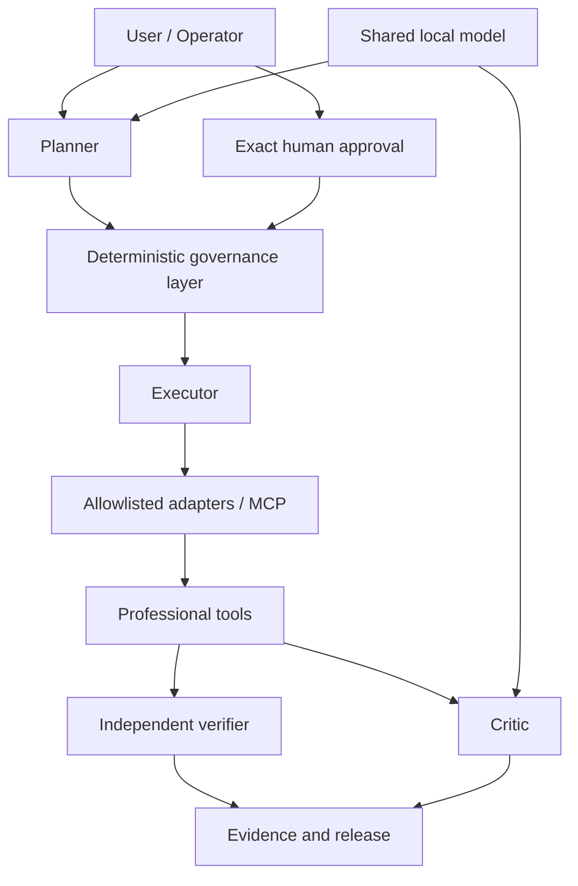
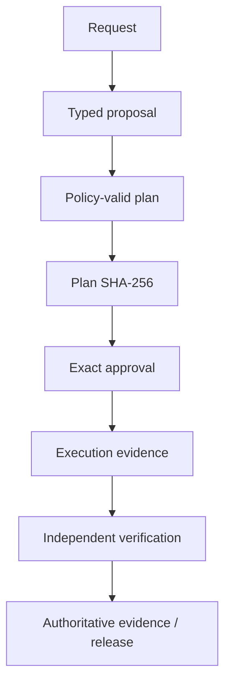

# Architecture

## Core principle

> Models propose; deterministic software authorizes, executes, validates, and
> records evidence.

(Direction, not implemented: an experimental, opt-in model approver is planned for
Phase 8 — see [server autonomy design](../docs/product-direction/SERVER_AUTONOMY_DESIGN.md#model-participation-in-authorization).
Current code has no such path.)

Generated text is untrusted input. It cannot grant permissions, approve a
mutation, select arbitrary executable entrypoints, or declare its own work
successful.

## Core components

Phase 0 development check: [import layers](../docs/IMPORT_LAYERS.md) statically maps
current Python modules to explicit layers and rejects regressions. After R6, strict
mode passes with zero upward dependencies and no dynamic-import debt. This is a static
dependency result, not execution permission or proof about same-layer cycles. Runtime
boundaries below remain enforced independently.

## Native package ownership after R6

```text
apps / CLI / HTTP adapters                 L6
              |                           |
task_actions                              L5
              |                           |
agents (roles, runtime, memory) / evolution L4
              |                           |
capabilities (registry, recipes, skills)   L3
              |                           |
data / workspaces                         L2
              |                           |
core (policy, ledger, verification)        L1
platform (configuration, storage, gateways) L1
              |                           |
contracts                                 L0
```

Imports may stay within a layer or point down; not every call traverses every layer.
Shared deterministic policy and record readers no longer import Planner/Critic
behavior. Data code owns calculations; agents own generation and interpretation.
The platform's fixed internal MCP client remains distinct from application MCP tools.

R11 [compatibility retirement](../docs/R11_COMPATIBILITY.md) removes 290 obsolete
adapters and moves maintained callers/launchers to native owners. The project now
has 613 modules: 496 native implementations and 117 supported public/SDK/schema
boundaries (60 package roots, 57 aliases). No ordinary native caller imports a
compatibility module. The immutable R6 inventory and exhaustive R11 partition bind
the boundary; source gates reject reintroduced adapters and hidden implementations.
Public re-exports and required aliases share actual native objects/locks/context.
The reserved candidate-loader namespace stays separate from trusted native source.
The analytical image bundles minimal native CSV/profile code, verified under an
isolated standard-library-only Python process; no new image was built during tests.

Earlier R6 ownership snapshot: historical leaf paths aliased native modules; package roots retained exports.
A source-bound manifest audited 391 compatibility adapters at R6 completion, including
61 package roots; R7's current count is recorded below.
Lower native layers cannot import these L6 adapters. This preserves old stored/generated
entrypoints and shared locks/context identity while native callers use responsibility
owners. R11 owns their eventual retirement. R7's CLI split is implemented below; HTTP
decomposition is recorded under R8 below. P0-5b contracts are recorded separately
below; R12 server seams are not delivered by moving files. Earlier R2–R6b sections below describe extraction stages; their old paths remain
compatibility paths. [Current ownership and validation](../docs/R6_COMPLETION_AND_ACCEPTANCE.md).

## Specialized persistence (P0-5b)

`platform/storage/ledger_contracts.py` defines immutable record, attempt/event journal,
write-policy and successful-method units. `ledger_provider.py` supplies context-scoped
local factories; file/SQLite implementations preserve existing workspace layouts.
Domain services retain canonical schemas/hashes, scope, verification and authority.
General metadata repositories cannot replace or delete immutable ledger records.
Local owner/session leases remain in core policy; cross-store writes are not one
transaction and an uncertain write never allows replay. No distributed backend is
implemented. [Contract inventory and failure/concurrency requirements](../docs/LEDGER_CONTRACTS.md).

R9's shared PostGIS transaction driver remains in data (L2), since it depends on
DB inspection; pure policy/ledger/verification contracts stay below it. R10 is the
existing P0-6 frontend/store split. Their [reconciliation](../docs/LEDGER_CONTRACTS.md#r9-and-r10-reconciliation)
reuses delivered work, with no second lifecycle or UI redesign. R12 is implemented
below. Local stable identity is implemented; the real owner cutover remains pending.
R11 retires compatibility last.

## Trusted action context and execution services (R12)

Optional [stable project identity](../docs/PROJECT_IDENTITY.md) is owned by
`platform/project_identity.py`. It verifies private UUID/source/state bindings before
workspace access, task dispatch or audit. Write-owner leases use the stable scope;
existing audit rows keep their original scope as provenance. Offline adoption and
rename rebind use local leases; state cutover retains UUID and previous identity.
Legacy projects remain path-bound. RunContext paths remain strict resource locators;
no moved/copied project inherits fresh approval. Cross-filesystem source transfers
and host/container aliases need future provisioning. No role or model changes.

`contracts/task_context.py` defines immutable Actor, RunContext, budgets and admission
decisions. `core/execution/actions.py` validates scope and performs admission/claim/
call/audit around fixed first-party task functions. `platform/action_context.py` carries
lineage and shared admission budgets; scoped `platform/execution_services.py` supplies
local policy, UTC clock, no-issue credential broker and context-copying in-process queue.
Seventy explicit task entrypoints, all 27 MCP ingress callbacks and ordinary CLI/HTTP
ingress use this boundary. MCP callbacks bind their server service profile while
retaining the fixed data-operation aliases and original tool schemas.
Public request/tool schemas remain unchanged; actor/context kwargs are trusted Python
inputs, never model authority. HTTP's optional event key only prevents repetition.

`platform/storage/action_ledger.py` owns a separate local SQLite claim/event ledger,
source-project binding and bounded verified reads. MCP uses a separate trace-mount
audit namespace, retaining read-only container permissions and fixed-operation aliases. Designated pure lookups use a
bounded transient query sink (512 events), retaining actor/run without project writes;
processing, mutations and explicitly keyed events use durable claims. Server handlers
capture and install their service profile explicitly in HTTP threads. It links actor/run to returned record
IDs without rewriting existing canonical records. Claims precede dispatch; uncertainty
never permits replay. Policy allow admits the call to its existing exact authorization
checks. A completed action can mean queued; existing workflow evidence determines
operation success. No distributed queue, authentication, new credential issuer or
cross-process delegation protocol is implemented. [Contracts, limits and evidence](../docs/EXECUTION_CONTEXT.md).

## CLI application composition (R7)

`apps/cli/main.py` constructs the same WorkspaceTyper app and re-exports original named
callbacks. `apps/cli/registry.py` registers existing commands in their historical order.
Command groups own argument definitions/rendering only and call the existing shared
task actions/services; their implementations do not import one another. `common.py`
owns the unchanged typed failure renderer. Eight small pre-existing registrars move
into the application package with aliases at old paths; `geoagent_harness.cli` aliases
native main while preserving Python module and installed entrypoints.

The main is 142 lines, registry 290, largest group 783. Baseline metadata for 150
top-level commands, 165 help screens and 110 original functions is verified separately
from execution tests. CLI loading/commands retain optional dependency behavior. No
agent, execution or authorization logic moves into the CLI. Current graph: 862 modules,
400 audited compatibility adapters (61 package roots), zero upward/dynamic debt.
[Structure, verification and manual acceptance](../docs/CLI_COMMAND_STRUCTURE.md).

## HTTP application composition (R8)

`apps/http/server.py` owns startup/public service exports (172 lines), `transport.py`
owns the existing origin/JSON/response/model-selection boundary (84 lines), and the
explicit dispatcher preserves 21 GET branches and 50 POST paths (103 lines). Ten
routers contain typed parsing and existing service calls; the largest is 198 lines.
`errors.py` retains ordered error mapping (133 lines). Unknown routes cannot fall
through to execution. The old server module aliases native composition.

Six task-action owners contain 24 unchanged legacy coordinator/helpers. Existing
execution actions now also own the former inline cache hydration and task-reference
linking; their locks, identities and failure scopes remain. Sixteen request schemas
and finite limits have neutral contract owners. Routers receive existing roots and
trusted public service bindings explicitly; they import neither server nor other routers.
No model-selected binding, new agent, operation, authority or server seam is introduced.
Current graph is 893 modules / 3,209 imports, 407 audited compatibility adapters
(61 package roots), zero upward/dynamic debt. R6/R7 counts above are their completion
snapshots. [Evidence and deferred combined acceptance](../docs/HTTP_ROUTER_STRUCTURE.md).

- **Model:** one shared local Ollama/Qwen endpoint. Model connectivity does not
  imply tool authority.
- **Planner Agent:** receives a bounded context pack and creates a structured,
  non-executing proposal.
- **Executor Agent:** accepts only an exact authorized artifact and dispatches
  fixed approval-gated operations.
- **Critic Agent:** reads bounded deterministic evidence, identifies unresolved
  risks, and produces a schema-constrained assessment without changing status.
- **Optional capability preparation:** Planner proposes closed data-only CSV adapter candidates; fixed backend workers test them, Critic assesses applicability, and the operator explicitly installs eligible exact versions. The historical Builder lifecycle remains a separate compatibility/experimental path, not an extra agent in this pilot.
- **Human Operator:** approves or denies an exact digest and consequential step
  scope. A changed artifact requires a new decision.
- **Harness:** owns schemas, policy, state, digests, approvals, redaction,
  timeouts, failures, traces, and artifact rules.
- **GIS/MCP boundary:** owns professional-tool dependencies and credentials and
  exposes only typed, allowlisted operations.
- **Verifier:** independently reloads authoritative artifacts and inspects
  resulting state. It is deterministic software, not an LLM agent.
- **Evidence and release:** preserve digest-addressed execution, verification,
  history, and release artifacts.

## Authority structure



The Planner and Critic use distinct manifests, contexts, and permissions even
when they share a model runtime. The Executor has no model access. Tool and
database credentials remain inside the professional-tool boundary.

## Governed artifact chain



Each downstream artifact identifies the exact upstream artifacts it depends
on. Digests are recomputed at trust boundaries. Missing, changed, expired, or
inconsistently scoped evidence fails closed.

## Runtime topology

Phase 0 [workspace consolidation](../docs/WORKSPACE_STORAGE.md) separates source/data
identity from the closed set of internal runtime stores. Shared services and CLI artifact
defaults use the same resolver; explicit roots remain explicit. Artifact references stay
logical; source identity binds write sessions and migrated workspace ownership. Offline
copy/cutover verifies SQLite logical state and unchanged evidence bytes. Optional archival
keeps old records; rollback rejects newer state. Legacy locations remain until an owner
chooses migration. This changes storage resolution, not the agent/container topology.
Compose host runtime mounts can use the configured root; mount permissions and existing
container destinations remain unchanged.

- Planner and Critic can reach only the shared model network required by their
  roles.
- Executor can reach only the fixed internal MCP control boundary.
- GIS/MCP owns controlled data mounts, GIS dependencies, and approved PostGIS
  connectivity.
- Planner, Executor, and Critic do not receive PostGIS credentials.
- Trusted plans, recipes, approvals, contexts, and registries are read-only at
  execution boundaries.
- Runtime artifacts can be written only beneath their dedicated bounded roots.

See [runtime boundaries](RUNTIME_BOUNDARIES.md) for the mount and access matrix.

## PostGIS reference lifecycle

Checkpoints 15A–15K demonstrate the complete governed lifecycle for a
consequential mutation:

```text
bounded inspection
-> deterministic comparison
-> deterministic change assessment
-> digest-bound promotion plan
-> exact promotion approval
-> serializable promotion execution
-> independent promotion verification
-> digest-bound rollback plan
-> separate rollback approval
-> serializable rollback execution
-> independent rollback verification
```

Inspection, comparison, and assessment accept no arbitrary SQL. Promotion and
rollback execute only fixed identifier-safe mutations. Both verifiers reload
and rehash the artifact chain and inspect PostGIS through separate read-only
transactions rather than trusting executor claims.

P0-3 shares these mechanics through `postgis/lifecycle.py` (decision checks, fixed
transaction driver/choreography and independent reader lifetime), `postgis/attempts.py`
(workspace-bound exclusive claims and append-only stage journals) and
`postgis/artifact_storage.py` (immutable canonical records). Existing promotion/rollback
packages retain their public schemas and import paths. An exact decision has one attempt;
commit uncertainty requires inspection and a new decision, never automatic replay.
The relation-profile contract remains metadata/count based. See
[scope, recovery and validation](../docs/POSTGIS_LIFECYCLE.md).

## Shared task actions (P0-4)

`task_actions/` owns existing chat/submission coordination, typed workflow edits and
reviews, exact decisions/dispatch, durable runs/cancellation/recovery proposals, and
recorded results/assessment. `artifacts.py` and `contracts.py` own saved-plan and
approval actions extracted from the HTTP server; `execution.py` owns exact dispatch
and durable progress. Existing registry, policy, runners and workspace storage remain
the execution boundary. HTTP, CLI and existing MCP tools import the shared owners;
terminal chat uses the same API and session policy. Old service modules alias the
actual shared modules, preserving identity of locks and context variables.

Shared actions do not import HTTP/CLI/MCP-tool implementations. Legacy Advanced/
assurance and some inventories remain in the HTTP module. Shared settings now have
the platform owner below; old MCP settings imports remain compatibility aliases.
Later router restructuring remains separate.
See [entry points and verification](../docs/TASK_ACTIONS.md).

R5 separates shared proposal validation/edit (`planner.recipe_definition`), immutable
plan save (`planner.service`), fixed spatial wrappers (`postgis.fixed_operations`),
closed action/assessment/export schemas and bounded recorded observations from task
controllers. Compatibility exports retain function/class identities. The role
coordinator receives the existing conversation lock/read/client factory explicitly;
its context, budgets and revision guards remain. Completed method retrieval uses a
bounded non-recovering storage reader; run actions retain recovery. The unchanged
snapshot encoder stays in the same metadata transaction. Main CLI service imports
use an explicit lazy task-action catalog returning current backend functions, without
new MCP/agent tool exposure or command/output changes. R6 ownership is implemented
above; R7 CLI decomposition is implemented above and R8 HTTP decomposition remains
open. See [composition and evidence boundaries](../docs/TASK_ACTIONS.md#r5-shared-composition-and-evidence-boundaries).

## Platform configuration (R2)

`platform/configuration.py` creates immutable allowlisted snapshots with a shared
`LayoutConfiguration` and lazy typed tool/model/internal-client/replay views. Existing
environment aliases/defaults and request-local model/reasoning override precedence
remain; no global cache or eager model requirement is added. Shared tool results live
in `contracts/tool_results.py`. Five former settings/schema modules alias their owners,
while production callers import neutral modules directly. Historical generated source
retains old imports/bytes. Configuration reads no credentials or provider services and
grants no authority. Personal is the only implemented profile; stable project IDs,
real-record migration and server seams remain separate. See
[precedence, compatibility and validation](../docs/PLATFORM_CONFIGURATION.md).

## Storage repositories (P0-5)

`storage/contracts.py` defines closed operational metadata transactions/records,
settings and file/plan access. `provider.py` selects local SQLite/file adapters at
trusted application composition; models cannot select a provider. `sqlite.py` owns
SQL for the existing planning database. `files.py` owns bounded JSON reads, atomic
run persistence/lookups and exclusive plan creation with the original parser.
Task actions retain domain validation, revision checks, authority and recovery.
Reads use coherent snapshots; writes retain immediate locking/rollback. Legacy raw
SQLite consumers have explicit compatibility. Existing configuration/formats remain.

R3 puts transaction/identity/bounded planning-JSON mechanics in `storage/metadata.py`,
used directly by lower-layer clients. Task actions re-export the same transaction/raw
helpers and retain memory/provenance validation via their existing-record reader.
Plan DTOs now live in `contracts/planning.py`, with an exact `planner.schemas` module
alias; common errors share `contracts/errors.py` identity. Existing parser, serialization,
limits, SQLite code and authorization remain. See
[boundary and compatibility](../docs/STORAGE_REPOSITORIES.md#r3-transaction-and-plan-contracts).

Only local adapters are implemented. Specialized authority/evidence/lifecycle stores,
ranking, legacy JSON writing and filesystem leases retain their existing mechanics;
distributed storage/coordination is not delivered. See [contracts and acceptance](../docs/STORAGE_REPOSITORIES.md).

## Shared data access (R4)

`sandbox/inspection.py` owns the existing bounded reader, with its fixed worker,
finite spatial snapshots and rendering beside it. Task actions retain eligibility,
revision/authority/dispatch checks, internal execution contexts and recorded-run/view
concurrency scope. Unchanged action/format/batch contracts and context redaction have
neutral owners; the generic result-redaction profile remains distinct. Shared root
validation and bounded outcome projection live under platform. Legacy modules and
exports preserve identity; native imports use their owners. Reader/process/resource,
serialization/hash and execution policy are unchanged. This adds no operation, agent
or stronger sandbox boundary. See [ownership and validation](../docs/DATA_ACCESS_BOUNDARY.md).

## Shared execution controls and contracts (R6a)

`platform/execution_control.py` owns the unchanged observer ContextVar, cancellation
exception and checkpoint/progress forwarding; `recipes.control` aliases that module.
Pure graph helpers are in `contracts/graph.py`, aliased by `planner.topology`.
`contracts/critic.py` owns unchanged Critic schemas, with an exact legacy module alias.
Four self-contained workflow/handoff Executor types are in `contracts/execution.py`;
`executor.schemas` re-exports the same classes and keeps its recipe-specific result
with domain validators. Native readers use the neutral owners; generated/stored paths
remain compatible. All 12 public schemas, canonical graph/record bytes and authority
rules remain. Subsequent R6 ownership and moves are recorded above. See
[scope and verification](../docs/SHARED_EXECUTION_PRIMITIVES.md).

## Shared evidence collection and records (R6b slice)

`platform/evidence.py` owns existing deterministic trace/report collection;
`storage/critic_records.py` and `storage/critic_record_storage.py` own existing canonical
record construction and package persistence/loading. History and release callers use
these owners directly. The three former Critic modules alias their actual owners;
the role retains model interpretation and its public exports. Limits, redaction,
schema/status/identity checks, source references, canonical bytes and authority remain.
An evidence digest establishes integrity rather than scientific truth. This removes
two dependencies without adding a model call or agent. Subsequent R6 policy/registry/
ledger ownership is recorded above; these are not new P0-5b ledger/concurrency contracts.
See [responsibilities and verification](../docs/SHARED_CRITIC_EVIDENCE.md).

## Trusted registry and installed metadata (R6b2)

`contracts/skill_registry.py`, `table_arguments.py`, `text_transform.py` and
`operation_packages.py` own existing data-only definitions and package identity.
`platform/skill_registry.py` loads the fixed current YAML and verified installed
metadata through `storage/operation_packages.py`. Two exact legacy registry aliases
and partial class/function exports preserve compatibility. Native callers use shared
owners; generated/stored strings remain. Package testing/install/dispatch stay separate.
The directory helper retains its existing explicit install/create path. Reading
metadata makes no model call, tests or installation and grants no authority. Approval
still loads the current registry and runs the unchanged full policy chain. No cache,
new version pin or migration is added. Subsequent R6 Planner-policy and recipe-ledger
ownership is recorded above; P0-5b remains separate. See
[scope and validation](../docs/TRUSTED_REGISTRY_BOUNDARY.md).

## Frontend workspaces (P0-6)

`interface/src/App.tsx` composes workspace controllers and views. Under `workspaces/`,
the provider-owned React store holds shared state; graph/DOM references and transient
or legacy forms remain local hooks. Pure projections, model derivation, typed action
ports and unconditional effects are separate responsibilities. Render-bound action
ports retain existing asynchronous scope guards. Selected-chat identity is explicit
for recorded-run lookup. UI batching is not data authorization or durable storage.

Planner, Graph/inspector, Results/history/review, Settings and Advanced views retain
the existing DOM structure and API clients. Restoring a workflow or navigating cannot
grant authority or dispatch operations; backend scope/session/digest verification
remains required. No Guided mode, state dependency or visual redesign is introduced.
See [ownership, limits and validation](../docs/FRONTEND_WORKSPACES.md).

## Historical Builder generated-extension lifecycle

The current optional data-only path is documented in [checkpoint 28.1](../docs/development/checkpoints/CHECKPOINT28_1.md); arbitrary generated Python is not enabled by it. The historical Builder cannot promote its own output. Generated candidates pass through:

```text
bounded request
-> candidate generation
-> path and content inspection
-> isolated materialization
-> network-disabled tests
-> deterministic review
-> exact human approval
-> transactional promotion
-> activation
-> post-activation verification
```

This preserves the same separation between intelligence and authority when the
system proposes extensions to itself.

28.2 adds `planner.outcome_recommendations`: bounded dispatch-contract-bound check metadata in existing SQLite, chat-private ranking supplied to Planner, and relevance-first recipe tie-breaking. No new agent/container; Critic assessments remain distinct. See [scope and limits](../docs/development/checkpoints/CHECKPOINT28_2.md).

28.2 paired evaluation reuses conversation/review/write-policy/durable-run services in disposable projects, with independent CSV/spatial result checks. The toolbar uses registered access for presentation and freshly prepares authoritative scope before direct read-only execution; writes still require exact approval. Recommendation receipts expose policy and supplied ordering, never inferred model adoption.

## Explicit inspection submission — 28.2

The [CSV-first submit coordinator](../docs/development/checkpoints/CHECKPOINT28_2_INSPECTION_SUBMIT.md)
wraps existing conversation validation, immutable plan storage and durable runs.
A deterministic policy plus fixed bounded reader enforces explicit user intent,
exact source content, chat revision, contract and no-approval read scope. Additive
submission receipts prevent replay and permit read-only reconciliation. Existing
conversation reads and plan-only commands do not dispatch. No extra LLM agent or
container is added. [Non-RL learning direction](../docs/LEARNING_WITHOUT_RL.md) is
separate proposed work, not execution authority.

## Typed result exploration — 28.3

[Result exploration](../docs/development/checkpoints/CHECKPOINT28_3_RESULTS.md) shares the existing verified
artifact reader between preview and typed full-bounded-file queries. Closed
filter/sort/page/aggregate contracts produce stable source-row IDs, bounded
profiles and explicit source/matching scopes. Planner proposes result_view from
recorded own-chat metadata; the coordinator checks scope/fields and preserves the
workflow. UI applies one explicit request, never replays it on restoration, and
uses existing tabs/charts/maps. No separate execution engine, extra agent or
model-derived plotted values are introduced.


## Checkpoint 28 discovery consolidation — 2026-10-22

[Baseline, revised target and delivery](../docs/development/checkpoints/CHECKPOINT28_DISCOVERY_RESTRUCTURE.md).
The [closeout record](../docs/development/checkpoints/CHECKPOINT28_CLOSEOUT.md) adds closed exact-request
proposals to the explicit submission coordinator, bypassing model calls while
retaining policy and revision-checked conversation persistence. ON/OFF UI sends
both use receipts; only ON can dispatch eligible bound reads. Batch source/contract
bindings cover every step, <=4 inputs / <=1 GiB aggregate, with serial scheduling
through the existing durable coordinator. Model conversation compatibility remains.
CLI submit-inspection shares that path; CLI/MCP discovery share discovery/service.py.
No optional method-helper calls are made on the exact route; transcripts still
persist. Broader requests and advisory Critic work retain their existing roles.
Spatial discovery adds TIFF/GPKG/SHP metadata adapters: private aliases to opened
no-follow file descriptors let drivers read characteristics without a full source
copy, pixel array or geometry frame. The same worker streams each closed component
and records its manifest/hash after stat/path checks. This is observed consistency,
not immutable capture or full content validation. `discover-dataset` and interface
inspection share this worker; legacy spatial CLI/MCP tools retain old behavior.
Detailed characteristics live in Outcome Overview; bounded Map reads stay explicit.
Raster technical details are an optional typed additive result: bounded TIFF
header/tag extraction in the same worker, not a new agent or external gdalinfo
runtime call. Exact band-1 overview sizes come from overview headers. Metadata
expansion uses the saved result and never requests statistics or pixel reads.
Existing source identity, output budgets and old-record readability remain.
No additional model role, process daemon, dependency or Docker image is introduced.
The first slice extracts shared no-follow path access into discovery/source.py
(re-exported by tabular.service for compatibility) and a streaming CSV reader.
Existing inspect_csv services/CLI/MCP call that reader; automatic and reviewed
interface inspections use it through the bounded worker. Submission probes expose
only column/source characteristics to Planner, not sample values or authority.
Worker metadata arrives over a bounded inherited pipe and is persisted by the
existing execution observer. Counts/hash complete in the existing durable run;
no new agent, daemon, container, queue or user mode is introduced. Spatial snapshot
and small-data transformation/exploration contracts remain separate. Statistical
inspection, source identity and display scope must not be conflated.

## Recorded basic inspection quality (2026-11-11)

The shared table reader now maintains bounded basic quality counters alongside the
existing scan. `data/tabular/basic_profile.py` owns aggregate output and pure saved-fact
reporting; candidate numerical moments reuse field guidance. Existing workflow handoff
and readiness projections render those facts for transports/downloads, without a
source read or model call. No agent/authority boundary or public input schema changes.
[Contract, budgets and validation](../docs/INSPECTION_QUALITY_REPORTS.md).
