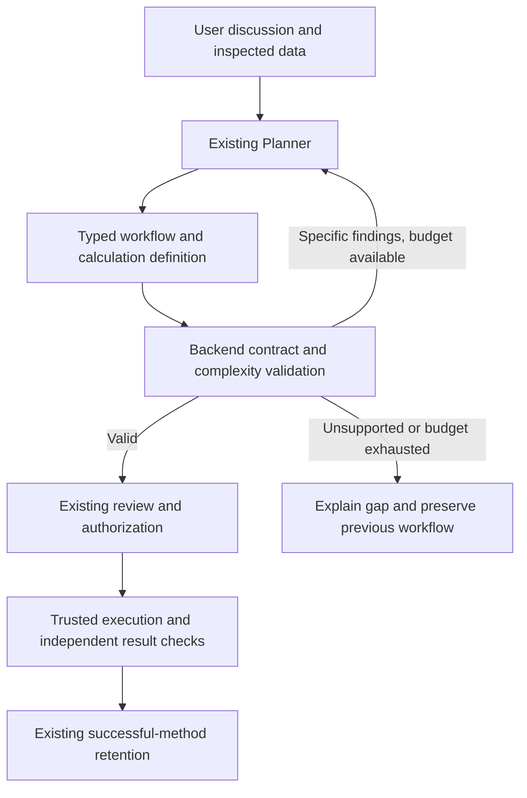

# Bounded calculations and Planner effort budgets

Recorded: 2026-10-17. **Original design preserved.** The operator subsequently authorized implementation; see [implemented behavior, limits and acceptance](BOUNDED_CALCULATIONS.md). Defaults and acceptance below record the original proposal, not additional implementation claims.

The operator requested recording this design before implementation. This does not
expand checkpoint 27 acceptance or authorize runtime changes. Prioritize existing
data/demo validation; schedule this bounded extension explicitly afterward or
when a demonstrated data-workflow gap justifies it. Preserve the current roadmap,
private-chat boundaries and checkpoint history.

## Purpose and architectural change

Expand useful no-code transformations without requiring Planner to develop
arbitrary software during ordinary planning. Add one trusted table-calculation
operation accepting a typed expression tree. Initially support numeric arithmetic,
comparisons and conditionals. Missing-value, division-by-zero, numeric overflow,
type-conversion and output-column collision behavior must be specified before
implementation. Broader string/date/statistical functions remain later work.

The expression evaluator must not use unrestricted Python, eval or arbitrary
library calls. Calculation definitions have no imports, loops, user-defined
functions, package installation, network access or direct database access. Reuse
trusted table input/output services and their existing path, resource and authority
checks. A validated expression is a composition of supported primitives, not an
automatically promoted executable-code extension.

## Responsibilities: agent versus service

| Component | Planned responsibility | Boundary |
| --- | --- | --- |
| Existing Planner agent | Translate intent into a typed formula; identify missing semantic assumptions; repair from concrete findings | Cannot change budgets, authorize itself or add unsupported primitives |
| Shared backend request coordinator | Enforce cumulative call/context/time budgets and record usage | A feature cannot allocate a fresh independent allowance for itself |
| Shared operation registry | Describe the calculation operation, typed parameters/results, requirements and effects | Existing operation IDs/digests remain compatible |
| Backend calculation service | Validate expression structure, references/types/complexity; evaluate supported primitives | No arbitrary generated Python or hidden external effects |
| Existing execution and verification services | Dispatch the validated operation, enforce output authority and check artifacts/results | Model confidence is not proof of correctness |
| Existing persistence/recipe services | Store definitions, assumptions, versions and verified evidence for reuse | Success with one input does not prove general applicability |
| Existing interface and CLI | Submit the same typed contracts; display formulas, assumptions, findings and budget receipts | No frontend-only enforcement or mandatory manual JSON |
| Existing Critic role, optional | Interpret recorded outcomes and limitations | No required extra call for ordinary calculations; cannot override failed checks |

No new agent, subagent, mandatory model, container, MCP server or model-training
process is proposed. The calculation and budget components are deterministic
backend services. Planner gains a constrained proposal ability. Critic remains
optional. Separate generated-code development/promotion is deferred.

## Initial quantitative ceilings

These are proposed prototype defaults, not measured optimal values and not claims
about current enforcement. Lower existing operation/data limits always prevail.

| Dimension | Proposed ceiling |
| --- | --- |
| Calculation generation | One candidate plus at most one repair |
| Whole Planner turn | At most four model calls total, including discovery and correction; no nested per-feature budgets |
| Each complete Planner prompt | Existing 64 KB ceiling; no silent dropping of essential scope |
| Serialized calculation definition | 8 KB, with exact byte convention fixed in the contract |
| Derived columns | Five per calculation operation |
| Expression complexity | 100 expression-tree nodes across the definition, maximum depth eight |
| Candidate preview/test batch | At most 100 rows, subject to stricter existing limits; not the full execution row limit |
| Functions/operators | Explicit versioned allowlist only |
| Timeout/execution-failure retries | No automatic retry |
| Unsupported effects | No package installation, imports, loops, arbitrary Python, network or direct database access |

The single repair consumes the existing turn correction allowance rather than
adding another one. Deterministic checks do not require a model call. Preview/test
invocation count and test-runtime caps must be fixed during implementation and
must not permit an unbounded testing loop. Planner never increases its own budget.

Calibrate an overall request deadline on measured laptop behavior before choosing
a default. Subsequent calls receive only the remaining time and respect per-call
timeouts; expiration prevents further dispatch. Cancellation/interruption semantics
must be explicit rather than promising that every underlying computation can be
instantly terminated. Configure output-token ceilings where the endpoint supports
them and record usage when available; do not equate bytes, tokens and reasoning
effort or invent token counts when the endpoint omits them.

Budgets are ceilings, not quotas. Record model calls, prompt bytes, available token
usage, tool/test invocations, elapsed time, repair count and stopping reason. Judge
benefit using independently correct-result rate, valid-plan rate, latency and human
interventions, not token reduction alone. Any separate optional helper/assessment
calls must be accounted for explicitly, never hidden in the Planner-turn count.

## Delivery sequence and measurable acceptance

1. Define versioned expression/operation schemas and precise numeric/missing/error
   semantics. Demonstrate known-answer examples independently of model claims.
2. Implement deterministic validator/evaluator and resource bounds. Reject invalid
   columns/types/operators, excessive nodes/depth and unsafe expressions before
   dispatch. Use temporary fixtures only.
3. Register and integrate through shared backend services, graph/inspector, Planner
   and CLI. Reuse fresh-output authorization and dependency validation. Matching
   interface/CLI definitions must produce matching results and findings.
4. Enforce cumulative request budgets. Test discovery plus generation plus repair,
   exhaustion, timeout, unsupported endpoint usage reporting and saved-plan
   preservation. Record actual laptop measurements before tuning defaults.
5. Exercise conversation -> definition -> review -> authorize writes -> execute ->
   independently checked output -> reopen/reuse on compatible data. Include
   missing values, invalid numeric input, division by zero, collisions and failures.

Opening previews or retained definitions must not execute a workflow or make model
calls. A candidate preview must use only declared bounded read-only inputs, with no
hidden file/database writes. Full execution retains existing data/resource limits
and exact authorization requirements. Domain correctness needs trusted rules or
known-answer checks; structural validity alone is insufficient.

## Explicitly outside this slice

Automatic arbitrary-code generation/promotion, new sandboxed Python execution,
dependency installation, reinforcement learning/model-weight changes, cross-chat
knowledge sharing, conversational authorization redesign and installable packaging
are separate decisions. This design neither implements nor authorizes them.
