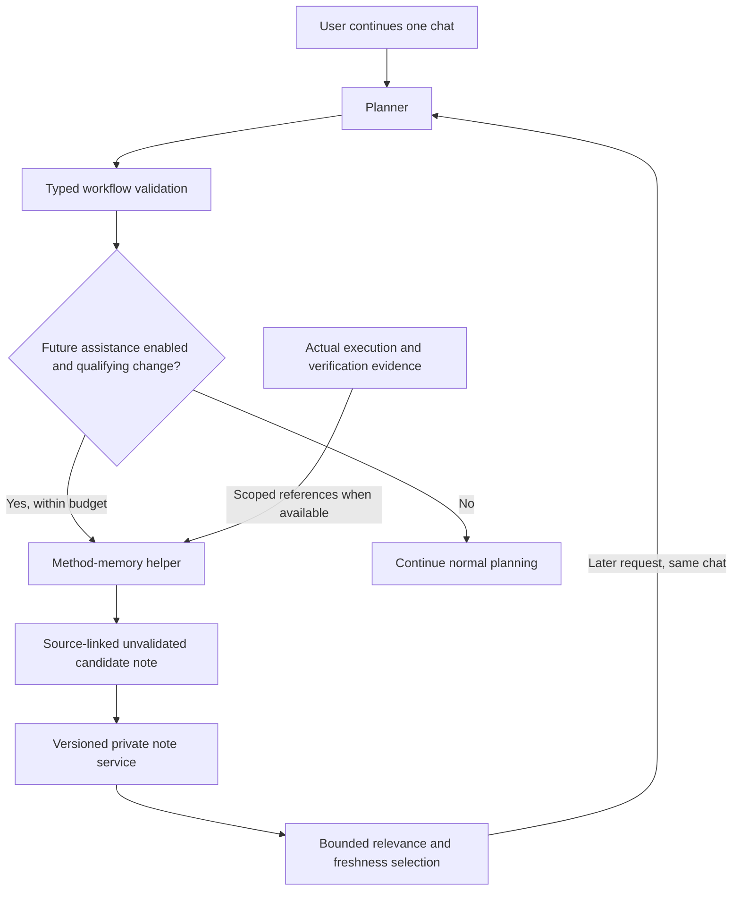

# Method-memory helper — proposed independent module

Recorded: 2026-10-14, initially documentation only. The operator subsequently authorized a trial implementation. The first workflow-only integration below is implemented experimentally; broader evidence/lifecycle work remains future scope. Cross-chat and execution authority boundaries are unchanged.

## First integration — implemented experimental scope

Settings offers **Automatic method notes**, OFF by default, with one persisted project-local switch. It is independent of the legacy manual method-service enable setting and the browser's Chat memory switch, which still controls recent transcript excerpts only. No source-selection, review, save or method-selection steps are required in normal chat.

The separate `interface_api/method_helper.py` module provides stable `context_for_turn`, `after_turn`, `observe` and setting interfaces. Planner consumes a versioned `NoteBundle`; helper prompts, extraction/cache logic and version can evolve behind that boundary. Changing the contract still requires coordinated changes. The helper reuses the existing logical manifest/model endpoint, with no new container, download or dependency.

After a changed, validated Planner workflow is durably saved, or a changed validated graph workflow is bound to its chat, the coordinator makes at most one serial helper request. It passes operation IDs, step IDs, purposes and dependencies. It does not read datasets or pass transcript excerpts, argument fields or database bindings. Purpose text may itself contain literal details; redaction and method validation are incomplete privacy filters, not anonymization guarantees.

Notes are **machine-generated, unvalidated**, classified as **validated plan only**. They carry owning chat, exact full-plan SHA-256, source conversation revision, contract/helper version and reported generating model. No execution/verified-outcome learning is implemented. The helper cannot execute, approve, install services or establish that a method is verified.

A later Planner turn can receive a cached note only for that chat's exact base workflow and available operation contracts; its inclusion is recorded in the actual request receipt. Notes never override the latest request, typed contracts or approval gates. This is conservative scope matching, not a proven semantic relevance engine: Planner must assess applicability to a requested change. Users can inspect notes/source classification in Context sent to Planner.

Opening a chat, restoring its workflow, enabling the helper or reading a cache makes zero model calls. Explanations/unchanged workflows do not generate notes. Existing workflows without notes need a subsequent changed validated revision before generation; enabling does not process a backlog. Successful notes and failed attempts are cached by chat/full workflow/helper-prompt/operation-contract fingerprint. Unchanged scopes are not automatically retried; OFF/ON alone does not retry failed scope. Explicit retry controls remain future work.

The normal plan is saved before helper processing. Malformed, oversized, unavailable or timed-out helper responses return status without undoing the plan. Old notes are not used for mismatched new workflows. OFF prevents retrieval/generation and invalidates in-flight results, including an OFF/ON cycle. If OFF changes during an already note-assisted Planner request, that reply is discarded while the previous saved workflow remains. Note storage/schema errors fail closed for inclusion while ordinary planning stays available.

Resource bounds: one automatic helper call active per project **in this API process**, serial after its Planner call; 6 KB source, 14 KB prompt, 3.5 KB response/note, at most 768 output tokens and a 15-second-or-shorter HTTP timeout. This is not a hard whole-turn deadline or inference cancellation. The browser waits for the optional stage before receiving the saved plan, so assistance can add latency. Other independent model consumers/processes are not globally scheduled by this lease.

SQLite caches at most eight entries per chat and 128 per project, each at most 7 KB. Oldest helper cache entries may be evicted; transcript, immutable workflows and manual reviewed-method history are untouched. Failed scopes retain safe diagnostic codes. Source changes during processing discard results. Cache checks plus a project lease handle repeated/concurrent delivery. This is not a complete retained version/supersession lifecycle.

API/CLI parity: `POST /api/v1/method-memory` and `method-memory --request-file REQUEST.json --project-root PROJECT` accept `helper_state`, `enable_helper` (enabled/expected_setting_revision) and `inspect_helper` (conversation_id). Turns/bindings invoke the same helper coordinator. Successful results report no approval/execution. Manual methods remain separate and compatible.

### Frontend acceptance on the laptop

1. Restart `bash scripts/start_actioncharter.sh`; refresh `http://127.0.0.1:5173`.
2. In Settings turn Automatic method notes ON. No model request should start merely from enabling. The setting must survive reopening, new chats and refresh.
3. Create a new chat and send: **Inspect sample_orders.csv with inspect_csv. Return row count and column names. No writes.** Wait for the validated workflow; one optional helper call follows. No Authorize/Execute click is needed.
4. Expand Chat history & context → Context sent to Planner. Expect an unvalidated note with validated-plan-only source evidence and one extra request reported. Read prerequisites/checks/limitations. Literal filenames, invented success claims or unjustified rules are quality failures to record.
5. Send: **Explain this workflow without changing or executing it.** The completed request should show the machine-generated note included; unchanged workflows cause no additional helper generation.
6. Refresh/reopen: workflow/note recover without generation. Another chat must not inherit the note.
7. Turn Automatic method notes OFF and send another explanation. No note should be included or generated; saved chat/workflow remains. Chat memory is still a separate recent-message preference.
8. A helper timeout/schema failure must leave the normal workflow available. Inspect status rather than modifying operation/approval records to bypass failure.

Record installed model, success/failure, added latency and usefulness. Fixture results do not establish laptop-model quality/performance. Execution-evidence extraction, corrections/revocation, semantic retrieval, cache retry controls, global scheduling and cross-chat memory remain future work.

### Verification of this first slice

`make test`: **1,570 passed**. `make interface-validate`: passed, with the existing large-bundle advisory. All **ten** private browser groups passed, including opt-in persistence, one helper call for a changed workflow, cached inclusion, model-free reload, OFF blocking, cross-chat isolation and timeout fallback. Backend fixtures additionally exercise malformed/unsupported output, source limits, graph binding, source/setting changes, concurrent delivery, incompatible cached contracts and shared CLI inspection. Models are deterministic fixtures; policy/storage/CSV execution services are actual. No live-service calls or page errors occurred. Laptop-model note usefulness, latency and comparative quality remain unvalidated.

## Current implementation versus proposed work

| Area | Current behavior | Proposed future work |
| --- | --- | --- |
| User interaction | One Planner chat; Chat memory controls bounded recent excerpts; own latest workflow restores automatically | Keep the same simple interaction; no mandatory source/review/selection workflow |
| Method helper | Opt-in workflow-revision invocation, private unvalidated cache and typed exact-scope delivery; legacy manual API retained | Evidence learning, semantic applicability and correction lifecycle |
| Planner context | Saved conversation/workflow plus opt-in private exact-scope note bundle; manual method selection remains compatible | Semantic relevance/lifecycle extensions after evaluation |
| Runtime | Existing backend process/model endpoint; no background memory loop | Initially reuse that process/endpoint and serialize helper calls; no extra container/model required |
| Sharing | Conversation-local; cross-chat memory deferred | Stay conversation-local initially; sharing remains a separate checkpoint-30-or-later decision |

The existing [prototype guide](METHOD_MEMORY_PROTOTYPE.md) describes delivered experimental services and the current simple interface. Chat memory does not activate automatic notes; the new Settings switch opts into the experimental path. Local-model note quality and checkpoint 26 completion are not established.

## Architectural decision

Prefer a **separate specialized helper module behind one user-facing Planner**. It is a logical agent role: its own instructions, selected context, input/output contracts and evaluation. It may be called a sub-agent functionally, but the first integration should use backend-controlled invocation rather than asking Planner to create/manage an autonomous agent team.

The helper owns interpretation/generalization of experience into useful methods. Trusted services own storage, event detection, scope enforcement, version checks and execution evidence. Planner owns dialogue, applicability assessment and workflow proposals. The helper has no execution tools, approval authority or ability to install new services.

A separate module can change prompts, extraction strategy, model configuration and private storage implementation without changing Planner **while its integration contract remains compatible**. Contract changes require coordinated migration. Initial wiring into Planner will itself require an implementation change; independent evolution does not mean zero integration work.

A new model call is still real compute even when it reuses the same model. A logical sub-agent is not automatically another OS process/container, another installed model or a stronger independent reasoner.

## Proposed future flow

The workflow-revision branch is implemented above; the execution-evidence branch/wider lifecycle remain proposed. No autonomous running loop exists. Opening a chat and restoring its workflow must remain model-free. A future helper timeout, invalid response or exhausted budget must leave ordinary planning usable. Failure must not silently replace a good existing note.

## What the helper should remember

Prefer a reusable procedure with:

- Purpose, suitable data types and expected input contracts.
- Preconditions and assumptions, including versions or scope where relevant.
- Suggested registered operations and their order; no executable generated code.
- Validation checks, expected evidence and known failure conditions.
- Limitations, unresolved questions and source references.

Example method: inspect both table schemas; verify join-key types and duplicates; select the required join behavior; join; inspect unmatched keys and row counts. A completed join alone does not establish correct keys.

Avoid a narrative such as “the user uploaded a particular file, tried a join and renamed a column.” Retain the general lesson and its qualifications. Do not promote a one-time workaround into a universal rule or treat model self-confidence as independent evidence.

A proposed workflow supports only a proposed method. A successful execution supports observations about that run; it does not prove universal applicability. Verified outcomes support stronger source evidence, but source evidence status and method validation status must remain separate. A failure supports a hypothesis about a cause until that cause is checked.

## Proposed stable boundary — not an implemented API

The integration should expose a small typed interface, rather than require Planner to understand memory tables or helper internals.

| Interaction | Minimum proposed information | Boundary |
| --- | --- | --- |
| Propose/update note | Owning conversation ID, exact source revisions/digests, allowed source excerpts/structures, evidence type, permitted operation IDs, resource budget | Sources are untrusted data; scope cannot widen to other chats |
| Return candidate | Contract version, note ID/revision, procedural content, assumptions/limitations, source references, evidence classification, unvalidated status | No execution arguments, approvals, runnable code or invented success claims |
| Select context | Current conversation/request/workflow, permitted note scope, byte/token budget | Return only relevant, current candidates plus an inclusion receipt; return empty when unsuitable |
| Supersede/revoke | Exact note revision, replacement/reason and retained provenance | Do not silently rewrite history or keep retrieving revoked notes |

These interactions need not be separate model calls. Retrieval/version checks can be deterministic; semantic generalization is the helper's job. Current experimental schemas are a starting point, not proof that these future contracts or automatic correction exist.

Changes to helper internals should preserve the published bundle shape. Versioned contract tests should detect incompatible changes before Planner integration is updated.

## Invocation and laptop resource policy

Proposed initial policy, subject to evaluation:

1. Automatic assistance remains opt-in under a separately reviewed future design. The current Chat memory switch keeps its existing meaning until then.
2. Trigger only on a meaningful validated workflow revision or relevant completed execution evidence. Do not run on opening a chat, every keystroke, every explanation or every UI refresh.
3. Deduplicate by source digest and helper/contract version. An unchanged source must not repeatedly generate notes; a stale note must not be reused solely because a cache exists.
4. Allow at most one helper call per qualifying event, with source/prompt/output and time budgets. Start without recursive delegation or automatic retries.
5. Prefer serial/on-demand processing using the installed model. Measure contention with Planner before considering background scheduling.
6. OFF blocks new processing and future note inclusion. An in-flight result must be discarded if its enable revision or source scope changed. Hard cancellation of model inference must not be claimed unless supported and tested.
7. Avoid routine user bookkeeping. A small status/inclusion disclosure may explain note use; do not reintroduce mandatory generation, editing and selection steps into normal chat.

This policy must be tested before activation. It is not permission to start a background worker now.

## Agent reasoning and deterministic services

| Concern | Agent contribution | Trusted service contribution |
| --- | --- | --- |
| Dependencies | Propose order; explain prerequisites | Validate DAG/data contracts; gate dispatch |
| Failure | Interpret recorded evidence; propose diagnosis | Preserve truthful attempts, outputs and verification status |
| Retry/resume | Recommend which remaining work is appropriate | Prevent duplicate writes; require current exact authority |
| Cancellation | Interpret the user's request; explain consequences | Signal supported operations and record actual stopping state |
| Method learning | Generalize procedure and qualifications | Scope sources, version records, enforce budgets and retain provenance |

These should be accessible through agent interaction, while their facts and permissions remain enforceable. Models do not establish actual completion, write rollback or durable state merely by describing them. Missing backend capabilities must enter the separate Builder/development lifecycle: candidate implementation, isolated tests and explicit promotion. Planner/helper output cannot install or enable new executable services during a workflow.

## Benefits, limitations and alternatives

| Choice | Benefit | Cost/limitation |
| --- | --- | --- |
| Put memory duties into Planner | Fewer separate calls/integration points | Larger prompt, mixed responsibilities and harder isolated evaluation |
| Planner chooses a memory sub-agent | Adaptive delegation | More decisions/loops for the small model; unpredictable extra calls |
| Backend invokes specialized helper — preferred first experiment | Predictable triggers/budgets; independent tests and module evolution | Extra model call and another failure path; fixed triggers may miss useful moments |

Potential benefits are concise context, reusable lessons for repeated workflows and independently testable extraction. They must be demonstrated against existing saved-chat/workflow context, not assumed.

Principal risks are false generalization, loss of exceptions during compression, confusing proposals with verified outcomes, stale or contradictory methods, and reinforced errors when both roles use the same model. Generalized procedures can still disclose private schemas, thresholds or business rules; removing filenames is not anonymization. Current-chat scoping, source references, correction/deletion and applicability checks remain necessary.

For unrelated or infrequent tasks, the extra inference may offer little benefit. A separate helper role alone does not improve model capability or establish reliable learning.

## Dependency-ordered future acceptance gates

These are broader acceptance gates: workflow-only contract/invocation fixtures are implemented; local-model quality and the complete lifecycle/recovery integration remain unfinished.

1. **Contract and evidence fixtures:** define bounded inputs/outputs and distinguish proposal, observed execution and verified outcome. Unsupported operations and any attempted authority transfer reject. Changing helper internals preserves Planner's supported contract.
2. **Small local-model evaluation:** compare plain saved-chat/workflow context with helper notes on repeated CSV and spatial tasks. Record usefulness, missed qualifications, false lessons, sensitive-detail carryover, latency, timeout/schema failures and peak resource usage. Agree numerical budgets before acceptance; do not invent performance targets already achieved.
3. **Optional automatic invocation:** prove unchanged sources cause zero repeated helper calls; chat opening causes zero model calls; calls stay within the configured event budget; OFF/source changes invalidate in-flight results. Invalid/slow notes cannot block ordinary planning.
4. **Applicability and lifecycle:** reject unrelated/stale/revoked notes; preserve source evidence and version history; test supersession, corrections, retention/deletion and inspectable inclusion receipts. Never mark an automatically produced candidate as operator reviewed.
5. **Agent-assisted recovery integration:** prove that an agent can explain/recommend recovery while trusted services still enforce partial-output checks and current authorization. No automatic repeated writes or generated-service promotion.
6. **Cross-chat decision gate:** no earlier than checkpoint 30, with fresh authorization and source/destination access, disclosure and revocation tests. A successful private helper does not authorize pooled memory.

Preserve existing checkpoint history: checkpoint 26 orchestration/recovery remains independent unfinished work; checkpoint 27 can host evaluations/demo preparation, 28 resource pilots and 29 lifecycle/privacy work. Helper activation depends on the evidence above, not on a promise to finish it in a particular checkpoint. Graph memory, semantic indexes, multiple background agents and separate deployment remain later options only if measured needs justify them.
