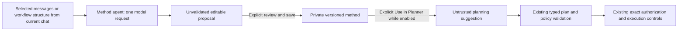

# Optional method-memory agent — checkpoint 26 prototype

Status: the original explicit method API/CLI remains compatible. A separate OFF-by-default **Automatic method notes** Settings switch now enables the first workflow-only helper integration: cached unvalidated advice without manual method-management steps. [Current scope, bounds and frontend acceptance](METHOD_MEMORY_HELPER_DESIGN.md#first-integration--implemented-experimental-scope) describe it. Local-model quality/latency remain operator acceptance; cross-chat memory/wider lifecycle remain deferred. Earlier manual-prototype descriptions below are separate/historical behavior, not required normal-chat instructions.

## Separate helper integration

The helper is independently changeable behind a versioned Planner contract and reuses the API/model runtime. It runs after a changed validated workflow is saved/bound, caches notes/failed attempts for exact scope and supplies own-scope advice to later requests. Opening a chat/enabling alone does not run it. Chat memory still controls recent messages separately. Automatic notes never become reviewed methods, execution evidence or authorization. Evidence-learning/correction/semantic-sharing remain future work.

## What runs

The logical `method_memory` agent shares the API process and configured model endpoint. Its manifest grants no tools, shell or filesystem/database execution permissions. The trusted coordinator handles explicit metadata saves. There is no new container, model installation, vector database, timer or background task.

## Current simple interface

The simple interface uses **saved chat/workflow context** by default; automatic notes require the separate experimental Settings opt-in. Planner has one **Chat memory** ON/OFF switch (default ON); ON includes bounded recent excerpts from that chat in its normal planner request, while OFF excludes those excerpts without deleting messages. The preference is remembered across chats in this browser; changing or creating a chat does not reset it. Existing per-chat settings are migrated once from the initially open chat when no shared setting exists. The current typed workflow remains explicit context in both cases.

Selecting a chat or refreshing automatically restores its own latest validated workflow. Recovery uses the conversation snapshot directly and revalidates/stores its immutable proposal artifact, reusing an existing identical artifact or recreating one if missing. It makes no model request, approval or execution and does not choose another chat's global bookmark. Open work/unsaved graph edits remain protected. Chat history & context remains a collapsed optional disclosure, not required bookkeeping.

There is no source picker, Generate method, Save reviewed method or Use in Planner step in the normal UI. Previously saved experimental method records remain intact; their explicit API/CLI service is described below for future tests. The legacy manual-service enable setting does not activate automatic notes; the new helper setting is separate.

## Data and authority flow



Only selected message indices from the requested conversation are sent, with common secret patterns redacted. Full selected text remains visible in the source picker. Workflow selection sends operation IDs, purposes and dependencies, omitting argument fields such as paths and target bindings. Purpose text can still contain literal details, including filenames. It does not open datasets or gather project-wide transcripts. Message text itself can contain sensitive details: pattern redaction is incomplete, and model generalization does not guarantee anonymization. Operator selection/review is required. Common concrete filenames/paths/service URLs in a method are rejected; arbitrary identifiers or private business rules cannot be reliably detected by this prototype.

The generated document contains title, purpose, inputs, prerequisites, ordered operation IDs/guidance, checks and limitations. The backend validates its closed shape, bounds and registered operation IDs. It does not validate that the method is useful, complete or factually correct. No arguments/code/callables are executable method fields. Planner must instantiate a fresh typed workflow, ask for missing scope and pass existing policy/approval gates.

Generated proposals stay in the current browser component until explicitly saved; discard or chat changes drop them. Saving creates a private method record with source conversation/revision, selected indices, workflow-selection flag, source-content SHA-256 and timestamp. Source text is not duplicated in method records. Model identity is shown by the generation API but is not independently authenticated or retained as a claim about edited saved content. Records retain up to eight saved versions; deletion removes the whole method and its versions, without deleting original chat messages. Secure erasure of SQLite pages/backups is not promised.

Saved methods are listed only for their own chat. Use in Planner selects one for the next request, without sending a message automatically. It is passed separately from recent chat excerpts, so history OFF does not silently remove a deliberately selected method. The context disclosure records actual method inclusion/version. Selection clears after a completed turn or chat revision change. Later requests do not retrieve methods automatically. A stale source blocks saving; a saved method remains an unvalidated suggestion as the conversation evolves. Generate a new proposal with current sources when needed.

OFF blocks new generation, method saves and method inclusion in Planner at the backend. Saved records remain inspectable/deletable. An OFF/ON cycle during generation invalidates its result; an already-sent model request may continue consuming compute until it returns or times out. No hard inference cancellation is claimed. The coordinator also checks settings/method changes before accepting a method-assisted planner result. Text already present in old messages remains ordinary chat history; OFF is not transcript deletion.

## Bounds and persistence

- One active method-generation request per project in this API process; no automatic model retry/correction. Other model-consuming features retain their existing behavior.
- Up to 8 selected messages, 12 KB source payload, 24 KB complete prompt, 16 KB returned document. Oversized sources reject without silent truncation.
- At most 12 suggested operations; 8 entries per input/prerequisite/check/limitation list, 600 characters per entry.
- At most 128 method records per project and 8 per chat (keeping list responses below 2 MB), 8 versions per record, 150 KB per record within the existing 64 MB SQLite project database guard.
- Reuses `planner-workspace/tasks.sqlite3`, ignored by Git and container builds. Reads while absent/OFF do not create storage. No existing conversation tables/history are replaced.
- Setting and method updates use revision checks/SQLite transactions; source revision is checked before generation/save and after model generation.

## Simple interface acceptance on the laptop

1. Restart `bash scripts/start_actioncharter.sh`; refresh `http://127.0.0.1:5173`.
2. Select an existing chat: its latest workflow must open directly. Select another chat and return: each must show its own latest workflow without generating it again.
3. Turn Chat memory OFF, refresh and return to the chat. Its switch preference, transcript and latest workflow must remain. New chats inherit the same ON/OFF preference; their transcripts/workflows remain independent.
4. Send “Explain this workflow without changing or executing it.” With OFF, Context sent to Planner must record zero recent messages and the current workflow included. Toggle ON and send again to include bounded recent excerpts.
5. No method-generation controls, extra method-model calls, authorization or execution are needed. Restoring a missing proposal artifact is a typed metadata save, not model regeneration or execution.

The earlier multi-step method-agent browser walkthrough was superseded by this simpler flow. Local-model method-generation quality/latency remains unvalidated; the normal Chat memory switch alone does not activate automatic notes.

## Shared API and CLI

`POST /api/v1/method-memory` uses the same service as `method-memory --request-file REQUEST.json --project-root PROJECT`. No request file means read the setting only. All successful responses explicitly report no approval/execution. The API uses the existing same-origin protection and request-body limit.

Example CLI request bodies (write your own local JSON request file):

```json
{"action":"enable","enabled":true,"expected_setting_revision":0}
```

Use the returned setting revision for the next toggle. List methods with `{"action":"list","conversation_id":"<32 lowercase hex characters>"}`. Generate with the conversation's exact revision:

```json
{"action":"generate","conversation_id":"aaaaaaaaaaaaaaaaaaaaaaaaaaaaaaaa","expected_revision":1,"message_indices":[],"include_workflow":true}
```

This placeholder chat ID must be replaced with your actual chat ID. `planning-conversation-read CHAT --project-root PROJECT` shows its revision. Save accepts the generated/edited `document`, same source selection/revision, and `reviewed:true`. Updating adds `method_id`/`expected_method_revision`; deletion requires that ID/revision and its owning conversation. `planning-conversation-turn --request-file TURN.json --project-root PROJECT` accepts the same typed turn request as the conversation API, including explicit `method_id`; no auto-retrieval is enabled. The HTTP conversation endpoint and CLI use shared backend validation.

## Current simple-flow verification

2026-10-14 follow-up: `make test` passed **1,552 tests**, `make interface-validate` passed, and all nine private browser groups passed. The browser verified one visible Chat memory switch, no method-management controls or method-service calls, preference persistence, latest-workflow restoration from the conversation even after removing its proposal artifact in the temporary fixture, no generation during recovery, isolated new chats and fresh authorization before real temporary CSV execution. Model replies were fixtures; no live-service calls or page errors occurred.

## Earlier experimental verification

Before the UI simplification, 2026-10-14: `make test` passed **1,552 tests**; `make interface-validate` passed. The six-group private browser journey passed using a deterministic model fixture and actual API/storage/policy/pandas execution services, with no live-service calls or page errors. It covers OFF default, enable without generation, selected-source generation, editing/reviewed save, explicit Planner inclusion, OFF blocking reuse, persistence and other-chat isolation. Backend fixtures also cover malformed/unregistered output, common-secret redaction, omitted workflow argument bindings, source limits/revisions, in-flight OFF/ON invalidation, ownership, version/setting conflicts, storage bounds/symlinks, HTTP origin/error handling and CLI parity. These results do not establish local-model extraction quality or laptop performance.

## Deferred complicated design — not implemented

| Later checkpoint/gate | Proposed capability | Evidence needed first |
| --- | --- | --- |
| 26 remainder | Single-chat indexed facts, source-linked corrections and applicability evaluation | Synthetic and laptop-model tests for false generalization, changed inputs/operations and harmful suggestions; existing orchestration/recovery still must finish |
| 27 | Demo/evaluation of optional assistance | Reproducible spatial/tabular examples; report quality/latency failures and baseline comparison |
| 28 | Resource-aware consolidation/cancellation | Measured RAM/model latency/power budgets; real inference cancellation or truthful discard semantics |
| 29 | Privacy/retention/correction lifecycle | Version supersession/revocation, export/deletion/backups, stale/conflicting-method tests and inspectable retrieval receipts |
| 30 or later, fresh decision required | Explicit multi-chat source selection and reviewed sharing | Enforced source/destination scope, disclosure review, no accidental pooling and no authority transfer |
| Later only if justified | Semantic search, temporal/linked graphs, background curator, automatic relevance ranking | Demonstrated benefit over small local indexed storage, bounded compute, traceable updates and rollback |

No cross-chat method library, shared summaries, automatic promotion, self-modifying executable skills, background model loop or independent memory container is delivered. Historical architecture proposals remain preserved; the [cross-chat deferral](DEFERRED_CROSS_CHAT_MEMORY.md) still applies.

Switch persistence follow-up: Chat memory now uses one browser-wide preference across chats. Settings’ Include private declarations switch is persisted too, surviving Settings close/reopen and refresh without automatically starting a scan. The shared preferences never share conversation content or execution authority. Verified with 1,552 tests, frontend validation and nine browser groups, including migration and both ON/OFF choices across chats, Settings remounts and refresh. If browser storage is unavailable, controls remain usable for the mounted session.
