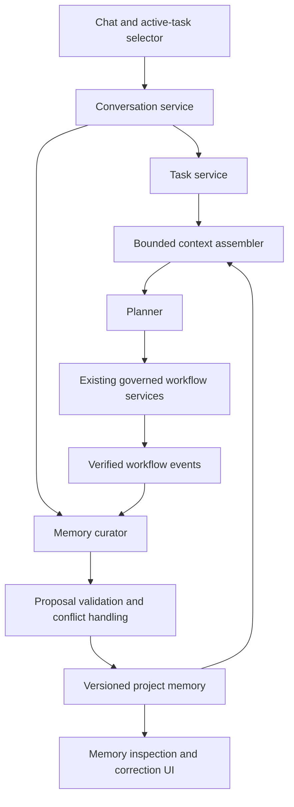

> Current implementation addendum: the [workflow-only helper](METHOD_MEMORY_HELPER_DESIGN.md#first-integration--implemented-experimental-scope) is an experimental opt-in with typed private notes, caching and fallback. Earlier deferred statements below describe prior decisions; evidence learning, lifecycle/corrections and cross-chat memory remain future scope.

> Future design recorded, not activated: prefer an [independent method-memory helper](METHOD_MEMORY_HELPER_DESIGN.md) invoked at bounded backend events, with a stable Planner contract. It is a logical sub-agent role, initially sharing the backend/model runtime. Automatic invocation, correction and relevant-note delivery require future evaluation and instruction.

> UI simplification: the operator chose saved chat/workflow context only. One Chat memory switch controls bounded recent messages; entering a chat automatically restores its latest workflow. Automatic method notes remain deferred. Experimental method APIs/CLI are retained outside normal UI for future tests.

> Current addendum: the [optional method-memory prototype](METHOD_MEMORY_PROTOTYPE.md) implements only explicit current-chat method proposals/reviewed saves/Planner advice. Local-model quality is unvalidated. Automatic indexed memory, corrections and all cross-chat features below remain future scope.

> 2026-10-14 operator decision: cross-chat memory is deferred until checkpoint 30 or later. No sharing work is authorized in 26–29. See [deferred dependency order](DEFERRED_CROSS_CHAT_MEMORY.md). Single-conversation history/core-memory work remains separate from the historical sharing proposals below.

# Project memory architecture — recorded proposal

Recorded: 2026-10-13. Incremental implementation is authorized. The operator then revised 26.1 to [one conversation, one task with private memory](CHECKPOINT26_CONVERSATIONS.md). The earlier task-sharing proposal is preserved below as historical design; it is not current behavior. Core facts, summaries, corrections and methods remain future work within one conversation. Laptop resource constraints remain.

## Operator revision — current implementation

The operator subsequently simplified the design: **one conversation = one task with private memory**, even when its topic changes between geospatial and CSV work. [Current 26.1 behavior](CHECKPOINT26_CONVERSATIONS.md) removes separate task selection and cross-chat linking. Core facts, summaries, corrections and methods should be developed within that conversation first. Cross-conversation sharing is deferred for discussion; prefer explicit source-linked project knowledge if it is later requested. The earlier many-to-many/project-memory proposal below is historical direction, not implemented shared memory.

## Goal and current boundary

Users should be able to move from vector inspection to CSV processing in the same chat, start another chat, or explicitly continue a previous task without mixing unrelated inputs and decisions. Relevant knowledge can be shared across chats within the same project.

Today, ActionCharter preserves Planner transcripts and the latest validated proposal, includes bounded recent excerpts when history is enabled, and retains separate execution evidence. Legacy conversation labels use the first user message, not a generated semantic summary. Automatic one-to-one conversation/task memory is implemented; cross-chat task linking is disabled. Automatic correction, indexed core memory, a curator agent and reusable methods remain proposed capabilities. Task-managed conversation labels use task titles rather than generated summaries.

## Structure

**Superseded proposal:** conversations and tasks would have had a many-to-many relationship: one chat can contain several tasks, and an explicitly linked task can continue in another chat. Workflow scope and authority remain bound to the exact proposal/run, regardless of chat or task selection.

## Records to introduce

| Record | Contents and purpose |
| --- | --- |
| Conversation | Original transcript, project identity, revision and explicit task links |
| Task | Goal, inputs, status, scoped context and proposal/run references |
| Memory entry | One claim/decision, topic, keywords, scope, source references, evidence class, freshness and version |
| Memory proposal | Curator-suggested addition, correction, dispute or supersession, with supporting sources |
| Method template | Reusable typed procedure, applicability, inputs, prerequisites and validation; no stored execution authority |
| Context snapshot | Exact transcript excerpts and memory versions included in an agent request, with selection reasons |

Memory layers: task-local working details; project-level confirmed decisions and methods; explicitly shared user preferences; optional lower-priority historical knowledge. Cross-project sharing is opt-in. Lower priority changes retrieval frequency, not automatic deletion.

## Curator and update lifecycle

The model-assisted curator extracts key points and method candidates after a completed conversation segment or relevant verified event. It proposes structured changes; backend services check sources, scope, revisions and conflicts before publication. It must not silently promote its own inference into a confirmed fact.

Proposed statuses: proposed, confirmed, disputed, superseded, expired and withdrawn. Evidence classes distinguish explicit user decisions, verified system outcomes and model interpretations.

- A verified system change creates a new version and supersedes affected information.
- An explicit user preference change becomes a source-linked new decision.
- A suspected error without evidence becomes a verification proposal or dispute.
- Time-sensitive information that is no longer current is excluded from default context until reverified.
- Conflicting sources remain visible until resolved.

Distinguish misinformation from changed circumstances: an earlier claim may have been wrong, or may have been correct at that time. Record the reason and preserve prior versions while retained. Correction must not rewrite execution evidence. Explicit privacy deletion must remove the applicable stored content and derived indexes, with its scope defined before implementation.

Freshness rules depend on content: preferences remain until changed; dependency information binds to an environment fingerprint; dataset facts bind to source identity; service/database facts require current checks when relevant. Calendar age alone does not determine correctness.

## Retrieval and laptop resource direction

Start with local structured storage and keyword/tag indexes, not a vector database or another always-running model. Combine recent excerpts with a small, bounded set of relevant core entries and optionally retrieved historical entries. Filter by project/task scope, freshness and evidence status before ranking; frequency alone must not make an entry core memory.

Use explicit on-demand or queued curation of completed segments, a single bounded model job at a time, and resumable processing keyed to source revision. Do not reload the full transcript for every request. Curator failure or disabled curation must leave existing planning and execution usable. Propose configurable context, record and queue budgets; select numeric limits only after measuring actual laptop capacity. No capacity benchmark or installation is part of this documentation change.

Semantic retrieval, embeddings and background maintenance remain optional later work. Keywords are transparent and inexpensive but can miss synonyms; a future semantic index must preserve provenance and resource bounds.

## Create and modify list

| Area | Create | Modify |
| --- | --- | --- |
| Storage | Task/memory records, versions, source links and indexes | Backward-compatible conversation project/task references |
| Backend services | Task lifecycle; memory search, correction, freshness and conflict services | Planner context assembly and event correlation |
| Curator | Typed extraction/update proposals, bounded job queue and source checks | Agent contracts and configuration; no new tool authority |
| Templates | Typed method records and applicability checks | Fresh proposal generation through existing policy |
| API/CLI | Equivalent task, memory, context-inspection and curation controls | Preserve existing conversation endpoints and saved formats |
| Frontend | Active task selector, task overview, project memory browser, versions/conflicts | Chat task boundaries, continue/new-task choice and expandable context-used details |
| Workflow integration | Source-linked completion/failure events | Task links on proposals/runs; preserve exact authorization checks |
| Acceptance/docs | Migration, retrieval, multi-chat and correction fixtures | Capability limits, roadmap and manual acceptance |

The UI can suggest whether a message continues, revises or starts a task. Ask for clarification when ambiguous references could select the wrong input or broaden scope. Creating a new chat is optional, not required merely to switch data domains.

## Proposed checkpoint 26 slices

Existing durable conversation/run state supplies the foundation for 26.1. Remaining scheduling/cancellation/recovery continues within checkpoint 26; task separation does not establish those capabilities. Only the revised private-conversation 26.1 is implemented; later memory slices remain planned.

| Slice | Depends on | Acceptance |
| --- | --- | --- |
| 26.1 — task separation and compatibility (implemented) | Recovery foundations and existing conversation storage | Two independent tasks coexist in one chat; a task continues across explicitly linked chats; switching preserves proposals and isolates inputs/authority; old conversations remain readable |
| 26.2 — deterministic project memory | 26.1 | Source-linked structured entries survive restart; bounded keyword/tag retrieval explains every included entry; unrelated project/task memories stay excluded |
| 26.3 — curator and correction lifecycle | 26.2 | Extraction/update proposals retain source revisions; contradictory, stale and unsupported claims remain visible; verified corrections supersede rather than silently overwrite; disabled/failed curation preserves the normal workflow |
| 26.4 — methods and optional history | 26.3 | Matching templates declare prerequisites and generate fresh validated proposals; optional history can be excluded; no template/history entry repeats a write or renews approval |
| 26.5 — operational acceptance | 26.1–26.4 | Restart, concurrent update, stale source, deletion and cross-chat conflict fixtures pass; context snapshots are reproducible; resource measurements document laptop limits |

Checkpoint 27 retains bounded output visualization, public-data demo preparation and prototype installation/evaluation materials. Do not expand its claims to features that have only been documented.

## Authority boundary

Transcripts, summaries, retrieved memories and method templates supply context only. Credentials and approval tokens are not reusable memory. A remembered approval never authorizes a new workflow, retry or changed scope. Existing typed validation, exact current authorization, execution services and independent outcome checks remain authoritative.
